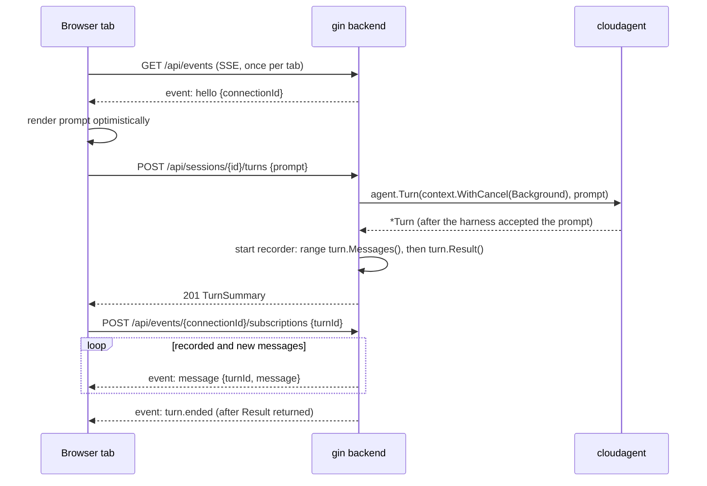

# 001 — Demo Architecture

## Status

Draft. Not implemented. The frontend is owned by [design 002](002-ui-shells.md).

## Why

The SDK's contract is designed for a system that drives harnesses from outside, but no such consumer exists yet. Without one, gaps in the API (no way to list or reopen agents, no cancellable message subscription, no wire encoding, no timestamps) are found late, by real users, and each workaround is invented anew.

A desktop coding app is the most demanding realistic consumer: it needs sessions, live streaming, stop, history, tool rendering, worktrees, and a dozen controls the SDK may not support. Recreating the Claude desktop app (Code mode) and the Codex desktop app on one backend tests the API against both harnesses at once, shows that a single integration serves both, and leaves behind a reference for the patterns a consumer needs (context handling, SSE replay, shutdown). The demo must expose gaps rather than paper over them, or it stops being a test of the API.

## Summary

1. One gin backend, bound to loopback only, holds sessions in memory. A session is one `AgentRuntime` with a fixed harness, WorkDir, and model.
2. JSON endpoints create, list, inspect, and delete sessions and start and stop turns.
3. One recorder goroutine per turn ranges `turn.Messages()` once, stamps each message, and keeps the turn's message record. Live delivery, reconnect replay, and history are all served from that record.
4. Each browser tab holds one SSE stream that carries session changes and the messages of the turns the tab subscribed to.
5. Messages cross the wire as the demo's own camelCase DTOs, built by a type switch over the SDK types.
6. Stop maps to `Terminate`, or to cancelling the turn's context while the turn is still starting. Deleting a session and shutting down the server both call `Close`, and cancel a turn that is still starting.
7. Worktrees are created and removed by the backend with `git`, and the worktree path is passed as `WorkDir`. Changed-file summaries also come from `git`.
8. Every SDK v1 gap has an ID, a reason, and either a disabled control in the UI or a named backend substitute.

The demo does not persist sessions, resume agents across restarts, restrict what agents may do, or run anywhere but next to the harness CLIs. See [Non-Goals](#non-goals).

## Start Here

A session is a conversation; the backend keeps a small state machine per session around the SDK's turn lifecycle.

```mermaid
stateDiagram-v2
    [*] --> idle: POST /api/sessions (cloudagent.New)
    idle --> starting: POST turns (agent.Turn called)
    starting --> idle: Turn returned an error
    starting --> running: Turn returned a *Turn (also after a stop during start; the turn then ends cancelled)
    running --> idle: Result returned, turn.ended published
    idle --> closing: DELETE or shutdown
    starting --> closing: DELETE or shutdown (start context cancelled)
    running --> closing: DELETE or shutdown
    closing --> [*]: agent.Close returned
```





## Design Decisions

| Decision | Choice |
|---|---|
| Process | One gin server; in development the Vite dev server proxies `/api` to it; otherwise it serves the built frontend from `--web-dir` |
| Binding | Loopback only (`127.0.0.1:8787` by default); non-loopback addresses are rejected at startup |
| Session identity | Session ID is `AgentRuntime.ID()` |
| Session storage | In memory only; lost on restart |
| Shell selection | The session's harness: `claude` sessions belong to `/claude`, `openai` sessions to `/codex` |
| Turn context | `context.WithCancel(context.Background())` per turn, never the request context |
| Active turn | At most one per session, guarded by the backend's state machine and enforced by the SDK |
| Turn end signal | The backend's `turn.ended` event, published only after `Result` returns |
| Message source | One recorder per turn ranges `turn.Messages()` once; every other reader uses the turn's record |
| Message transport | One SSE stream per browser tab, multiplexing session events and subscribed turns; replay position is an explicit `afterMessageId` per subscription |
| Ended-turn history | JSON, from the turn's record; the demo never reads messages back from the harness home |
| Wire format | The demo's own DTOs; `Raw` only with `--debug-raw` |
| Harness home | Isolated demo homes under `~/.cloudagent-demo/homes/` by default, with the user's Codex provider configuration copied in on creation; the user's real homes only with `--home-mode user` |
| Harness binaries | Found on `PATH`; `--harness-bin-dir` is prepended to `PATH` at startup |
| Worktrees | `git worktree add` by the backend before `cloudagent.New`; removed on delete only when clean |
| Changed files | `git diff` in WorkDir against the commit recorded when the session was created |
| Titles | First line of the first prompt, whitespace collapsed, cut to 60 characters |
| Timestamps | Stamped by the backend: by the recorder when it observes a message, and by the state machine on turn transitions |

### Harness home

An empty `Options.Home` makes the harness use `~/.claude` or `~/.codex` ([Construction](../../design/001-core-api.md#construction)). Demo sessions would then appear in the user's real Claude Code and Codex history, and the user's own settings, MCP servers, and memory files would apply to an agent running in bypass mode. The default is therefore `--home-mode isolated`: `Options.Home` is `<data-dir>/homes/claude` or `<data-dir>/homes/codex`, created on startup, where `<data-dir>` defaults to `~/.cloudagent-demo`. When the isolated Codex home is first created, the backend copies `~/.codex/config.toml` into it if that file exists, so the user's model provider configuration applies; it never copies `auth.json` or any other file, and never overwrites a `config.toml` already in the isolated home. The user logs in once per isolated home with the harness's own login flow under `CLAUDE_CONFIG_DIR` or `CODEX_HOME`; the settings view shows each home path and that command as `loginHint`, and there is no guided login flow. `--home-mode user` passes an empty `Home` and is an explicit opt-in. The demo never reads, copies, or prints credentials.

The SDK's own index is not under `Home`, and the demo cannot choose its location (gap `index-location`); the settings view says so.

### Safety

Harnesses always run without permission prompts ([Design Decisions](../../design/001-core-api.md#design-decisions)), so every session is an unrestricted agent in its WorkDir with the backend user's privileges. The backend therefore binds to loopback only, rejects requests whose `Host` is not a loopback name (DNS rebinding), requires `Content-Type: application/json` on every mutating request, and rejects requests whose `Origin` is neither the served origin nor the configured dev origin (cross-site requests from other pages). There is no authentication beyond this.

### Why in-memory sessions

The SDK has no API to list agents, reopen one by ID, or list a runtime's turns ([Non-Goals](../../design/001-core-api.md#non-goals)). Reading the SDK index or the harness transcripts directly would mean depending on SDK internals and harness-private files, which is exactly what the SDK exists to hide. So the sidebar shows only sessions created by the running backend process, and the missing history is gap `history`.

### Why one recorder per turn

The SDK lets any number of readers range `Messages()` concurrently, and replays from the first message on each call ([Turn](../../design/001-core-api.md#turn)). Ranging it once per SSE connection would still leave two problems: timestamps would differ per reader, an iteration cannot be cancelled when a browser goes away (gap `cancellable-messages`). One recorder per turn gives every reader the same sequence, the same IDs, and the same `receivedAt`, and makes every other wait cancellable because it waits on the demo's own record.

## Module

`demo/go.mod` declares `module github.com/wenfengwang/cloud-agent-sdk/demo`, `go 1.24` or later (the SDK uses package `iter`), `require github.com/wenfengwang/cloud-agent-sdk v0.0.0`, and `replace github.com/wenfengwang/cloud-agent-sdk => ../`. gin and other demo dependencies live only here. There is no `go.work` at the repository root.

Because the module path is under the SDK's path, the Go toolchain would accept imports of the SDK's `internal/` packages. A test in the demo fails if any package in `go list -deps ./...` has the prefix `github.com/wenfengwang/cloud-agent-sdk/internal/`.

## Directory Layout

| Path | Owns |
|---|---|
| `cmd/server/main.go` | Flags, configuration, `PATH` setup, isolated homes, server start, signal handling, graceful shutdown |
| `internal/api/` | gin router, handlers, request validation, error mapping, origin and host checks |
| `internal/events/` | Per-tab SSE connections, subscriptions, pumps, and the single writer per connection |
| `internal/session/` | Session store, per-session state machine, turn records, recorders, change events |
| `internal/sdk/` | The only package that imports `cloudagent`: thin interfaces over `AgentRuntime` and `Turn` so the rest of the backend can be tested with fakes |
| `internal/wire/` | DTO types and the conversion from `cloudagent.Message` and `cloudagent.Result` |
| `internal/gitwork/` | `git` calls: repository detection, branches, worktree add and remove, start commit, changed files and diffs |
| `internal/gaps/` | The gap registry served by `GET /api/config` |
| `web/` | The frontend; its layout is owned by [design 002](002-ui-shells.md#directory-layout) |

## API Surface

All routes are under `/api`. Request and response bodies are JSON with camelCase keys. Timestamps are RFC 3339 strings with milliseconds, stamped by the backend.

### Errors

Every non-2xx response has the body `{"error": {"code": "<code>", "message": "<human-readable>"}}`.

| Situation | Status | `code` |
|---|---|---|
| Malformed body, empty or whitespace-only prompt, unknown harness, relative or missing WorkDir, WorkDir not a directory, worktree requested outside a git repository | 400 | `invalid_request` |
| Unknown session, turn, or event connection | 404 | `not_found` |
| A turn is starting or running (backend state, or `ErrTurnInProgress`) | 409 | `turn_in_progress` |
| The session is `closing`, or `Turn` returned `ErrClosed` | 409 | `session_closed` |
| Stop was requested while the turn was starting, and `Turn` returned an error | 409 | `start_cancelled` |
| Messages requested as JSON for a turn that is still running | 409 | `turn_running` |
| Any other `Turn` error: CLI missing, harness rejected the prompt | 502 | `harness_start_failed` |
| `git` failed while creating a worktree or computing changes | 500 | `git_failed` |
| Server shutting down | 503 | `shutting_down` |
| Any other error, including a `cloudagent.New` error that validation did not predict, and a non-nil `Terminate` error | 500 | `internal` |

The backend validates every request before calling the SDK, because `New` and `Turn` return plain wrapped errors for invalid input. A start cancelled through its context returns `ctx.Err()` ([AgentRuntime](../../design/001-core-api.md#agentruntime)); the backend answers `start_cancelled` when `stopRequested` is set and `errors.Is(err, context.Canceled)`. The prompt may already have entered the harness conversation, so the response tells the user the next turn may still see it. A `Terminate` error is logged and returned as 500. A `Close` error is logged and returned as 500, but the session is removed either way.

### Configuration and projects

| Route | Response |
|---|---|
| `GET /api/config` | `Config` |
| `GET /api/projects` | `{"projects": [Project]}`: immediate subdirectories of each `--project-root`, plus every WorkDir used by a live session |
| `GET /api/projects/branches?path=<abs>` | `{"current": "main", "branches": ["main", "feature/login"]}`; 400 when `path` is not a git repository |

```json
{
  "displayName": "Alex Rivera",
  "harnesses": [
    {
      "harness": "claude",
      "label": "Claude Code",
      "available": true,
      "version": "2.1.300",
      "pinnedVersion": "2.1.300",
      "home": "/home/alex/.cloudagent-demo/homes/claude",
      "loginHint": "CLAUDE_CONFIG_DIR=/home/alex/.cloudagent-demo/homes/claude claude",
      "defaultModel": "",
      "modelSuggestions": ["model-a", "model-b"]
    }
  ],
  "homeMode": "isolated",
  "worktreeRoot": "/home/alex/.cloudagent-demo/worktrees",
  "projectRoots": ["/home/alex/code"],
  "debugRaw": false,
  "gaps": [{"id": "permissions", "reason": "The SDK always runs harnesses without permission prompts."}]
}
```

`available` and `version` come from running `<cli> --version` once at startup, because the SDK has no availability or version API (gap `harness-status`). `pinnedVersion` comes from the file named by `--harness-versions` (the repository's `harness-versions.json` has the expected shape) and is empty when the flag is not set, because the SDK exports no pinned versions (gap `pinned-versions`); the backend never reads repository files implicitly. A mismatch between `version` and a non-empty `pinnedVersion` is shown as a warning, because the SDK supports exactly the pinned versions. `displayName` comes from `--display-name`, defaulting to the OS user name. Model suggestions come from `--claude-models` and `--codex-models`; the SDK has no model list.

```json
{"path": "/home/alex/code/storefront", "name": "storefront", "isGitRepository": true, "currentBranch": "main"}
```

### Sessions

| Route | Request | Response |
|---|---|---|
| `GET /api/sessions` | — | `{"sessions": [SessionSummary]}`, newest activity first |
| `POST /api/sessions` | `CreateSession` | 201 `SessionDetail` |
| `GET /api/sessions/{sessionId}` | — | `SessionDetail` |
| `DELETE /api/sessions/{sessionId}` | — | 200 `{"worktree": {"path": "...", "removed": false, "reason": "uncommitted changes"}}`; `worktree` is null when the session had none |
| `GET /api/sessions/{sessionId}/changes` | — | `Changes`; 400 when WorkDir is not a git repository |

```json
{
  "harness": "openai",
  "workDir": "/home/alex/code/storefront",
  "model": "",
  "worktree": {"enabled": true, "baseBranch": "main"}
}
```

`harness` is `claude` or `openai`. `workDir` must be absolute and an existing directory. An empty `model` selects the harness default. `worktree` is optional.

```json
{
  "id": "0192f0c1-7a2b-7c3d-9e4f-5a6b7c8d9e0f",
  "harness": "openai",
  "title": "Add pagination to the order list",
  "projectPath": "/home/alex/code/storefront",
  "projectName": "storefront",
  "workDir": "/home/alex/.cloudagent-demo/worktrees/storefront/3f9c2a7e",
  "model": "",
  "worktree": {"path": "/home/alex/.cloudagent-demo/worktrees/storefront/3f9c2a7e", "branch": "cloudagent-demo/3f9c2a7e", "baseBranch": "main"},
  "status": "running",
  "activeTurnId": "0192f0c2-1d4e-7f60-8a1b-2c3d4e5f6a7b",
  "lastTurnStatus": "completed",
  "createdAt": "2026-10-14T09:12:03.120Z",
  "lastActivityAt": "2026-10-14T09:15:44.871Z"
}
```

That is a `SessionSummary`. `projectPath` is the directory the user picked and groups sessions in the sidebar; `workDir` is what was passed to `New` (the worktree path when one was created). `title` is empty until the first turn starts. `status` is `idle`, `starting`, `running`, or `closing`. `activeTurnId` is the running turn's ID while `status` is `running`, otherwise null; it lets every tab showing the session find a turn another tab started. `lastTurnStatus` is a turn status or null.

`SessionDetail` is a `SessionSummary` plus `"turns": [TurnSummary]` in start order.

```json
{
  "id": "0192f0c2-1d4e-7f60-8a1b-2c3d4e5f6a7b",
  "sessionId": "0192f0c1-7a2b-7c3d-9e4f-5a6b7c8d9e0f",
  "prompt": "Add pagination to the order list",
  "status": "completed",
  "startedAt": "2026-10-14T09:12:05.402Z",
  "endedAt": "2026-10-14T09:15:44.871Z",
  "finalText": "Pagination is in place ...",
  "usage": {"inputTokens": 1830, "outputTokens": 412, "cacheReadTokens": 20480, "cacheWriteTokens": 0},
  "error": null
}
```

That is a `TurnSummary`. `status` is `running`, `completed`, `terminated`, `cancelled`, `closed`, or `failed`. `startedAt` is when `Turn` returned; `endedAt`, `finalText`, and `usage` are set once `Result` returns. `usage` carries the SDK's [`Usage`](../../design/001-core-api.md#turn) counts unchanged. `error` is `{"message": "..."}` for `failed`, otherwise null.

```json
{
  "baseCommit": "4be1c0d",
  "files": [{"path": "web/orders.ts", "status": "modified", "additions": 12, "deletions": 3, "diff": "@@ -10,7 +10,16 @@ ..."}]
}
```

That is `Changes`: the working tree, including untracked files, against the commit that was `HEAD` when the session was created. `status` is `added`, `modified`, `deleted`, or `renamed`. Changes are per session, never per turn. A session without a worktree shares its WorkDir with whatever else edits it, so its changes also include edits the user made by hand in that directory since the session started; the review panel says so ([design 002](002-ui-shells.md#other-shared-pieces)).

### Turns

| Route | Request | Response |
|---|---|---|
| `POST /api/sessions/{sessionId}/turns` | `{"prompt": "..."}` | 201 `TurnSummary` once `Turn` returned; errors per [Errors](#errors) |
| `POST /api/sessions/{sessionId}/stop` | — | 202 `{}`; a no-op when the session is idle or closing |
| `GET /api/sessions/{sessionId}/turns/{turnId}/messages` | — | `{"messages": [Message], "error": null}` for an ended turn; 409 `turn_running` otherwise |

Stop is per session, not per turn, because a turn that is still starting has no turn ID: `stop` cancels the turn's context while the session is `starting` and calls `Terminate` while it is `running`.

`messages` is the turn's record. `error` is `{"message": "..."}` when the recorder's iteration ended with an error; the messages before it are still returned.

### Event stream

`GET /api/events` is the one SSE stream of a browser tab. It starts with `retry: 3000` and a `hello` event, carries session changes for every tab, and carries turn events only for turns this connection subscribed to.

| Event | `data:` | When |
|---|---|---|
| `hello` | `{"connectionId": "..."}` | First event of every connection |
| `session.upserted` | `SessionSummary` | After any change to a session (created, title set, status changed, turn ended) |
| `session.deleted` | `{"id": "..."}` | After a session was removed |
| `message` | `{"turnId": "...", "message": Message}` | Each message of a subscribed turn, in record order |
| `stream.error` | `{"turnId": "...", "message": "..."}` | The turn's recorder iteration ended with an error; no further `message` events follow for that turn |
| `turn.ended` | `TurnSummary` | After `Result` returned; the last event of a subscription, which then ends |
| comment `: keepalive` | — | Every 15 seconds of silence |

Events carry no `id:` field, and `Last-Event-ID` is ignored: a connection multiplexes several turns, so one position cannot describe it. The error event is named `stream.error`, not `error`, because `EventSource` already dispatches its own connection failures as `error` events.

| Route | Request | Response |
|---|---|---|
| `POST /api/events/{connectionId}/subscriptions` | `{"sessionId": "...", "turnId": "...", "afterMessageId": "..."}` | 204; 404 for an unknown connection, session, or turn |
| `DELETE /api/events/{connectionId}/subscriptions/{turnId}` | — | 204; a no-op when not subscribed |

A subscription delivers the turn's recorded messages after `afterMessageId` (all of them when it is empty or not in the record), then new ones as the recorder appends them, then `stream.error` if the iteration failed, then `turn.ended`. Subscribing twice to one turn on one connection is a no-op. A connection that ends drops all its subscriptions; after a reconnect the client subscribes again from the last message ID it holds. One SSE connection per tab keeps the demo inside the browser's limit of six HTTP/1.1 connections per host, which loopback without TLS cannot raise with HTTP/2.

## Message DTO

`internal/wire` converts each `cloudagent.Message` with a type switch over the payload and the concrete tool input and output pointer types. Kind and tool values are the SDK's string values unchanged; the SDK types are owned by [Messages](../../design/001-core-api.md#messages).

```json
{
  "id": "msg-id",
  "turnId": "turn-id",
  "parentToolUseId": "call-id-of-subagent",
  "kind": "tool_call",
  "receivedAt": "2026-10-14T09:13:10.004Z",
  "text": "...",
  "toolCall": {"id": "call-id", "tool": "shell", "rawName": "Bash", "input": {"type": "shell", "command": "go test ./...", "description": "Run tests", "timeoutMs": 120000}},
  "toolResult": {"callId": "call-id", "tool": "shell", "isError": false, "output": {"type": "shell", "output": "ok ...", "exitCode": 0}},
  "truncated": false,
  "raw": {}
}
```

| Field | Rule |
|---|---|
| `parentToolUseId` | Omitted when empty |
| `receivedAt` | When the turn's recorder observed the message; always set, and identical for every reader |
| `text` | Set for `user`, `assistant`, `reasoning`; may be an empty string for `reasoning` |
| `toolCall`, `toolResult` | Set for their kinds only; otherwise omitted, never null |
| `raw` | Only with `--debug-raw` |
| `truncated` | True when any field exceeded 512 KiB. A string field is cut at the limit. An embedded JSON value (`arguments`, MCP `content`, `raw`) is never cut in place; it is replaced by a JSON string holding a preview of its first 512 KiB |

Input `type` and its fields: `shell` {command, description, timeoutMs}; `fileRead` {path, offset, limit}; `fileWrite` {path, content}; `fileEdit` {path, oldString, newString, replaceAll}; `filePatch` {changes: [{path, kind, diff}]}; `glob` {pattern, path}; `grep` {pattern, path, glob}; `webFetch` {url, prompt}; `webSearch` {query}; `mcp` {server, tool, arguments}; `subagent` {description, prompt, type}; `unknown` {raw}. Output `type` and its fields: `shell` {output, exitCode (null when not reported)}; `fileRead` {content}; `text` {text}; `mcp` {content}; `unknown` {raw}. `arguments`, `content` (MCP), and `raw` are embedded JSON values, not strings, except when replaced by a preview string as above.

The frontend's TypeScript types mirror this table one to one.

## Turn Flow

1. **Start.** `POST .../turns` validates the prompt and, under the session lock, moves the session from `idle` to `starting` (409 `turn_in_progress` from `starting` or `running`, 409 `session_closed` from `closing`), stores a fresh `cancel`, and clears the session's `stopRequested` flag. It calls `agent.Turn(ctx, prompt, cloudagent.TurnOptions{})` outside the lock, then retakes the lock and decides in this order:
   - `closing` is set: a returned `*Turn` is dropped (no record, no recorder; `Close` is already stopping it and waits for it), and the response is 409 `session_closed`.
   - `Turn` returned an error: the session moves back to `idle`, `cancel` is called, and the response is 409 `start_cancelled` when `stopRequested` is set, otherwise the error mapped per [Errors](#errors).
   - `Turn` returned a `*Turn`: the backend records a `TurnSummary` with status `running`, sets `activeTurnId`, moves to `running`, sets the title if this is the first turn, publishes `session.upserted`, starts the recorder, and returns 201. When `stopRequested` is set the context is already cancelled, so the turn will end `cancelled`; the response is still 201, because a cancel that lands after the harness accepted the prompt cannot make `Turn` fail.
2. **Recorder.** One goroutine per turn ranges `turn.Messages()` once. For each message it stamps `receivedAt`, converts it to a DTO, appends it to the turn's record under the turn lock, and wakes the record's waiters. An iteration error is stored on the record. It then calls `turn.Result()` once, classifies the outcome, stores it in the `TurnSummary`, calls `cancel`, clears `activeTurnId`, moves the session to `idle` (unless it is `closing`), marks the record final, wakes waiters, and publishes `session.upserted`. A turn runs to its end whether or not any browser is connected.
3. **Subscriptions.** Each subscription has a pump goroutine that reads the record from its position and sends events into the connection's outgoing channel. Every send and every wait selects on the subscription's `done` channel, which is closed when the client unsubscribes, the connection's handler returns, or the server shuts down, so a pump exits as soon as its connection is gone. One writer goroutine per connection writes the outgoing channel to the response, which keeps each turn's events in record order.
4. **History.** For an ended turn, `GET .../messages` returns the record. The demo never reads a turn back from the harness home.
5. **Stop.** `POST .../stop` sets `stopRequested` and calls `cancel` when `starting`, calls `turn.Terminate()` when `running`, and returns 202. The final state arrives as `turn.ended`, or as the pending start's 409 `start_cancelled`.
6. **Delete.** `DELETE` sets `closing` under the session lock and publishes `session.upserted`; new turns get 409 `session_closed`. It calls `agent.Close()` and, when the session is `starting`, cancels the start context right after `Close` begins, because `Close` alone waits for a start that may never finish. `Close` stops and waits for a running turn, whose recorder then publishes `turn.ended`. The backend removes the worktree when the session created one and it is clean, removes the session, and publishes `session.deleted`. How a turn stopped by delete is classified (`closed` or `cancelled`) does not matter, because its session is being removed.

`Result` outcomes are classified in this order: nil is `completed`; `errors.Is(err, cloudagent.ErrTerminated)` is `terminated`; `errors.Is(err, cloudagent.ErrClosed)` is `closed`; `errors.Is(err, context.Canceled)` is `cancelled`; anything else is `failed` with the error message.

## Worktrees

| Step | Action |
|---|---|
| Create | Requires `projectPath` to be a git repository. Run `git worktree add -b cloudagent-demo/<suffix> <worktree-root>/<project-name>/<suffix> <baseBranch>`, where `<suffix>` is 8 random hex characters, then call `cloudagent.New` with that path as `WorkDir`. If `New` fails, run `git worktree remove` and then `git branch -D` on the branch just created, which has no commits of its own. |
| Start commit | `git rev-parse HEAD` in WorkDir, stored as `baseCommit` for [changes](#sessions) |
| Changes | `git diff <baseCommit>` for tracked files; untracked files from `git ls-files --others --exclude-standard`, each diffed with `git diff --no-index /dev/null <file>`. The index is never touched. |
| Delete | After `Close`, `git worktree remove <path>` without `--force`. If git refuses because of local changes, the worktree and its branch are kept and the response says so. The branch is kept in both cases. |
| Shutdown | Worktrees are left on disk. |

The only git commands that change a repository are `git worktree add`, `git worktree remove` without `--force`, and `git branch -D` for a branch the backend created in the same request that has no commits of its own. Every other git call is read-only. Two sessions may share a WorkDir; the SDK allows it and the agents will conflict on files, so the UI warns when a picked WorkDir already has a running session.

## Concurrency and Shutdown

- The session store has one lock for the map; each session has its own lock for its state machine; each turn record has its own lock. No lock is held across an SDK call.
- The SDK remains the authority on the single active turn; the backend's state machine exists so that `starting` can be stopped and so that `turn.ended` is never published before the SDK has released the turn slot.
- On SIGINT or SIGTERM the server: stops accepting connections (`http.Server.Shutdown` in a goroutine); cancels the shutdown context so SSE handlers return and every pump exits; sets `closing` on every session; calls `Close` on every runtime in parallel and cancels the start context of every `starting` session alongside it; waits for those with a 20-second overall deadline; then exits. Every `POST` during shutdown gets 503. `Close` must run on every runtime, and starts must be cancelled, or Codex app-server processes outlive the backend.

## SDK Gaps

This registry is the one owner of gap IDs and reasons. `GET /api/config` serves it; [design 002](002-ui-shells.md#disabled-gap-affordances) maps IDs to controls. "Visible" means the user sees a disabled control; "Backend" means the demo does the work itself and the gap is recorded for the SDK. Closing a gap is a change to the [root SDK design](../../design/001-core-api.md), not to the demo.

| ID | Desktop feature | Reason shown | Surfaces as |
|---|---|---|---|
| `history` | Sessions across restarts, resume | Sessions need an SDK API to list and reopen agents. | Visible: sidebar note |
| `permissions` | Permission and approval modes | The SDK always runs harnesses without permission prompts. | Visible: control labeled with the mode that actually runs |
| `effort` | Reasoning effort | Turn options have no reasoning effort yet. | Visible: control labeled "Default effort" |
| `model-switch` | Changing the model mid-session | The model is fixed when a session starts. | Visible: read-only model label |
| `model-list` | Model catalog | The SDK has no model list; suggestions come from configuration. | Visible: free-text model field |
| `context-usage` | Context window meter, cost | The SDK reports per-turn tokens only, without window size or cost. | Visible |
| `attachments` | Files and images in prompts | Prompts are text only. | Visible |
| `extra-directories` | Adding more directories to a session | A session has one WorkDir. | Visible |
| `voice` | Voice input | Voice input is not part of the SDK. | Visible |
| `cloud` | Cloud environments | The SDK runs harnesses on this machine. | Visible |
| `search` | Searching sessions | Searching needs an SDK transcript query API. | Visible |
| `streaming-text` | Typewriter text | Messages arrive complete, without deltas. | Visible: working indicator |
| `plan` | Plan and task checklists | Plan and task items are not part of the message model. | Visible: Claude Code: unknown tool calls; Codex: not shown, disabled "Plan" row |
| `steering` | Queueing, steering, edit and resend, rollback, fork | A turn cannot take input while it runs, and history cannot be edited. | Visible: input hint while a turn runs |
| `slash-commands` | Slash commands, hooks, custom tools, skills, MCP configuration | Not part of the SDK. | Visible |
| `chat-mode` | Chat mode | The SDK drives coding harnesses only. | Visible |
| `notifications` | Notifications, automations | Not part of the SDK. | Visible |
| `index-location` | Choosing where agent metadata is stored | The SDK index location cannot be configured. | Visible: settings note |
| `titles` | Generated session titles | The SDK exposes no title. | Backend: first prompt |
| `timestamps` | Message times, turn duration | Messages and results carry no timestamps. | Backend: recorder receive time |
| `changed-files` | Changed-files summary, review pane | The SDK has no diff API. | Backend: `git diff` |
| `stop-while-starting` | Stop before the harness accepted the prompt | No turn handle exists until `Turn` returns. | Backend: context cancel |
| `cancellable-messages` | Clean SSE disconnect | `Messages()` takes no context. | Backend: one recorder per turn |
| `message-encoding` | Wire format | Messages have no canonical JSON encoding. | Backend: DTOs |
| `harness-status` | Harness availability and version | The SDK has no API for harness availability or version. | Backend: `<cli> --version` |
| `pinned-versions` | Supported harness versions | The SDK exports no pinned versions. | Backend: `--harness-versions` flag, or empty |
| `stderr` | Separate stderr | Shell output is one string. | Visible: no stderr tint |

## Invariants

- The backend imports only the root `cloudagent` package, and only `internal/sdk` imports it.
- The demo writes no conversation data to disk. Everything it keeps (sessions, prompts, titles, timestamps, turn records) is in memory and derived from requests or SDK calls.
- No turn runs on a request context; a turn's context is cancelled only by stop, delete, or shutdown while the turn is starting, or after its `Result` returns.
- `turn.Messages()` is ranged once per turn, by its recorder; every reader is served from the record.
- `turn.ended` is published only after `Result` has returned.
- Message IDs are the only replay position (`afterMessageId`); positional indexes are never sent to the client.
- Every runtime is closed on delete and on shutdown.
- No pump or handler goroutine outlives its connection by more than one select.
- The server listens on loopback only and enforces the host, origin, and content-type checks.
- An SDK gap is never hidden behind a workaround that pretends the feature exists; every gap, including every backend substitute, is in the registry.

## Non-Goals

- **Persistence and resume.** Waits for the SDK's resume API ([Non-Goals](../../design/001-core-api.md#non-goals)); the demo will not read SDK or harness files to fake it.
- **Multi-user, remote access, authentication.** The demo is a local tool for one user.
- **Restricting the agent.** Permission control is an SDK non-goal; the demo adds no sandbox of its own.
- **Production hardening.** No rate limits, metrics, or horizontal scaling.
- **Git workflows beyond worktrees.** Commit, push, and pull request actions of the desktop apps are not recreated.
- **Per-turn changes.** Changes are computed against the session's start commit only; the backend takes no per-turn baseline, so there is no per-turn changes card.

## Testing

- **Backend unit tests** run the gin router with `httptest` against fakes of the `internal/sdk` interfaces. They cover every row of [Errors](#errors) and the state machine, including: stop while starting when `Turn` then fails (409 `start_cancelled`) and when it then succeeds (201, turn ends `cancelled`); delete while starting (the start context is cancelled, the pending POST gets 409 `session_closed`, no recorder starts); delete while running; `turn.ended` ordering after `Result`; a non-nil `Terminate` error; and shutdown closing every runtime and cancelling every start.
- **Event tests** cover subscriptions: `afterMessageId` resumption, an unknown `afterMessageId`, two connections receiving identical `receivedAt` values, `stream.error` followed by `turn.ended`, a second tab learning a running turn from `activeTurnId`, and goroutine count returning to its baseline after a client disconnects and one more message is recorded.
- **Wire tests** convert one SDK message per tool type and kind into its DTO and compare it against golden JSON, including truncation of a string field and preview replacement of an embedded JSON value. They construct SDK values through the public types only.
- **Git tests** run `internal/gitwork` against temporary repositories: worktree add and remove, rollback after a failed `New`, refusal on dirty worktrees, changes against the start commit including untracked files, and an unchanged index afterwards.
- **Dependency test** fails if any dependency is under the SDK's `internal/`.
- **Real harness smoke tests** start the backend against the pinned CLIs when `DEMO_E2E=1`, with isolated homes and `--harness-versions` set, and run one prompt per harness through the HTTP API.
- The demo does not use the SDK's fake harness: its script format is internal to the SDK.

## References

- [design/001-core-api.md](../../design/001-core-api.md): the SDK contract this backend consumes.
- [design/002-testing.md](../../design/002-testing.md): how the SDK itself is tested, including credential isolation the demo mirrors.
- [design 002](002-ui-shells.md): the frontend that consumes this API.
