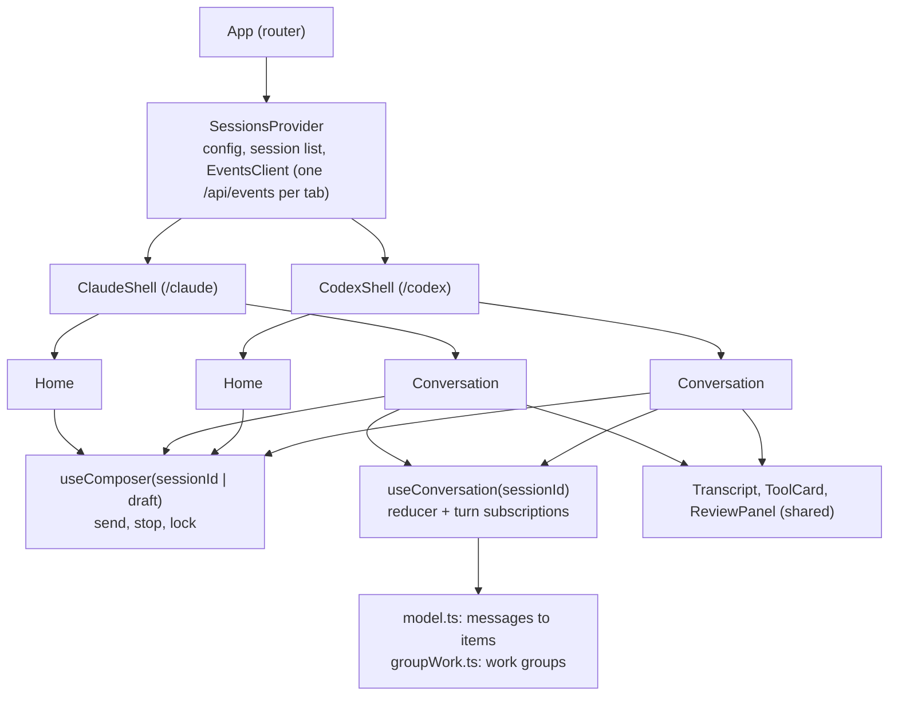

# 002 — UI Shells

## Status

Draft. Not implemented. The empty (home) state of both shells is specified from reference screenshots; the conversation, tool, running, diff, collapsed-sidebar, and settings views are specified from knowledge of the apps and are unverified until screenshots of those views are available (see [Open Questions](#open-questions)). The backend API this frontend consumes is owned by [design 001](001-architecture.md#api-surface).

## Why

The demo exists to test the SDK as a realistic consumer would ([design 001](001-architecture.md#why)). A generic chat UI would not do that: the desktop apps define what users expect from a coding agent (live tool activity, diffs, stop, worktrees, project grouping), and every control they show either maps to the SDK or exposes a gap. Recreating both apps' look and interaction makes those mappings concrete. Sharing everything below the shell proves that one integration serves both harnesses, and keeps the per-shell work to markup, labels, and tokens.

## Summary

1. One single-page app with routes `/claude/*` and `/codex/*`. Each shell owns its layout, chrome, markup, labels, and design tokens.
2. Session state, the API and SSE clients, the composer's send and stop flow, the project picker, the conversation model that folds messages into items, and every message and tool renderer are shared and read only semantic tokens.
3. A session is shown in the shell of its harness; each shell lists only its own harness's sessions.
4. Every control the SDK cannot support is rendered in place, disabled, with the reason from the [gap registry](001-architecture.md#sdk-gaps), and labeled with what actually runs.
5. Fidelity means matching layout, proportions, colors, type sizes, and interaction at the reference viewport, with fictional data and no official assets.

Out of scope: dark theme, mobile layouts, promotional surfaces and dashboards, and features of the apps unrelated to a coding session. See [Non-Goals](#non-goals).

## Start Here

## Design Decisions

| Decision | Choice |
|---|---|
| Stack | React, React Router, TypeScript (strict), Vite; pnpm, prettier, eslint, vitest |
| Dependencies | `lucide-react` for icons, `react-markdown` with `remark-gfm` for prose, `diff` for line diffs, `shiki` for syntax highlighting; nothing else without a design change |
| State | React context for config, the session list, and the events client; one reducer per open conversation; no state library |
| Theming | CSS custom properties with semantic names, defined per shell on `[data-shell="claude"]` and `[data-shell="codex"]` |
| Shared vs per shell | Shared: state, the events client, `useComposer`, `ProjectPicker`, `BranchMenu`, renderers, `ReviewPanel`. Shells own only markup, layout, labels, and tokens |
| Visual differences | Expressed as tokens (for example `--tool-card-border`, `--tool-card-hover-bg`), never as props |
| Structural variants | A shared component that differs in structure by shell takes a `variant` prop (`"claude"` or `"codex"`) or a named option; there are no shell-specific forks. Codex's "Worked for" grouping is the Transcript option `groupWork`, computed by a pure function next to `model.ts` |
| Session list per shell | Filtered by harness: `claudecode` in `/claude`, `codex` in `/codex` |
| New session | Created from the empty state by the first message; no dialog |
| Keyboard | In the composer, Enter sends and Shift+Enter inserts a newline; there are no other shortcuts |
| Shell switching | The Claude account menu opens `/codex`; the Codex workspace-title menu opens `/claude`. Claude's mode segment control does not switch shells |
| Untitled sessions | Shown as "New session" until the backend sets a title |
| Settings | Read-only; values come from backend flags through `GET /api/config` |
| Agent output | Always rendered as text or markdown without raw HTML |
| Theme | Light only |
| Window chrome | No traffic lights; the top row keeps the sidebar toggle and back and forward buttons |

## Directory Layout

| Path under `web/` | Owns |
|---|---|
| `src/api/` | `types.ts` (the [DTOs](001-architecture.md#message-dto) one to one), `client.ts` (JSON calls and error decoding), `events.ts` (the per-tab `EventsClient`: one `EventSource`, subscriptions, reconnect) |
| `src/state/` | `SessionsProvider`, `useConversation`, the conversation reducer, `useComposer`, `model.ts` (the [fold](#conversation-model)), and `groupWork.ts` |
| `src/projects/` | `ProjectPicker` (list, recent project, absolute path entry, empty state) and `BranchMenu` (branch list, worktree toggle) |
| `src/conversation/` | `Transcript`, item renderers, `ToolCard`, one renderer per tool, `DiffView`, `Markdown`, `CodeBlock`, working and turn-end indicators, the transcript skeleton, `ReviewPanel` |
| `src/gaps/` | `GapControl`, the steering input hint, and the control-to-gap map |
| `src/notices/` | Toasts, the connection banner, and the harness availability notice |
| `src/shells/claude/`, `src/shells/codex/` | Shell layout, sidebar, home, composer markup, conversation frame, tool labels, `theme.css` |
| `src/settings/` | The settings view, shared and themed |
| `src/styles/` | Base reset and the semantic token names with neutral defaults |
| `test/fixtures/` | Fictional DTO sequences used by tests |

## Routing

| Route | View |
|---|---|
| `/` | Redirect to `/claude` |
| `/claude`, `/codex` | Empty state; `?project=<abs path>` preselects the project |
| `/claude/sessions/:sessionId`, `/codex/sessions/:sessionId` | Conversation; a session of the other harness redirects to the other shell |
| `/claude/settings`, `/codex/settings` | Settings |

An unknown session ID shows an inline "Session not found" state that mentions gap `history`, because a restarted backend forgets sessions. Back and forward buttons use browser history. The sidebar's collapsed state and the most recently used project are kept in `localStorage` per shell.

## State and Data Flow

`SessionsProvider` loads `GET /api/config` and `GET /api/sessions`, and owns the tab's `EventsClient`: one `EventSource` on `GET /api/events` for the whole tab. It applies `session.upserted` and `session.deleted` to the list and routes `message`, `stream.error`, and `turn.ended` events by `turnId` to the conversation that subscribed.

`useConversation(sessionId)` loads `SessionDetail`, shows the transcript skeleton until it arrives, then fetches `GET .../messages` for ended turns, newest first, at most two at a time. When the session has an `activeTurnId`, it subscribes to that turn with `afterMessageId` set to the last message ID it holds. It also watches `session.upserted` for its session: an `activeTurnId` it is not subscribed to (a turn started in another tab) makes it refetch `SessionDetail` and subscribe. It unsubscribes on unmount.

`useComposer(sessionId | draft)` owns the send, stop, and lock flow for both shells. The composer is locked while the session's `status` is `starting`, `running`, or `closing`, or while this tab's own send is pending; it unlocks when both the session is `idle` and the turn's `turn.ended` has arrived (or the start failed). It never unlocks on the end of the message stream alone ([why](001-architecture.md#turn-flow)).

A prompt that starts with "/" is sent as plain text (gap `slash-commands`). While the input starts with "/", the composer shows a non-blocking hint below it, "Slash commands are not interpreted; this is sent as plain text", and Send stays enabled.

Sending a message:

1. The composer inserts an optimistic user item and shows the starting indicator. For a new session it first calls `POST /api/sessions` with the selected project, then navigates to the session route.
2. `POST .../turns` returns a `TurnSummary`; the hook subscribes to the turn.
3. The turn's first `user` message replaces the optimistic item.
4. `turn.ended` stores the summary and ends the subscription; the composer unlocks as above.
5. On a start error the optimistic item is removed, the prompt is restored to the input, and the error is shown above the input. `start_cancelled` restores the prompt without an error. When the first turn of a new session fails, the view stays on the session route with the prompt restored and the error shown, and the session is kept (listed as "New session"), so the failure stays visible and Send retries it.

Connection handling:

- The server sends `retry: 3000`, so `EventSource` reconnects on its own after a dropped connection. On every `hello`, the `EventsClient` refetches `GET /api/sessions`, and each open conversation refetches `SessionDetail` and subscribes again from its last message ID; a 404 then shows "Session not found".
- When the `EventSource` reaches `readyState` `CLOSED` (a permanent failure such as an HTTP error on reconnect), or has been disconnected for more than 3 seconds, a banner at the top of the main pane reads "Connection to the backend lost. Reconnecting..." with a "Reconnect" button that creates a new `EventSource`.
- `stream.error` shows an inline notice in that turn, "Some messages of this turn could not be read: <message>", and the subscription continues to `turn.ended`. Nothing is retried, because the recorder's error is final for that turn.
- The browser allows six HTTP/1.1 connections per host across all tabs, and loopback without TLS cannot use HTTP/2. Each tab uses one long-lived connection plus at most two history fetches, so more than about four tabs open on the demo at once can stall requests. This is a known demo constraint.

## Conversation Model

`model.ts` is a pure function from turn summaries and their messages to items, shared by both shells.

| Item | Built from |
|---|---|
| `user` | The `user` message, or the optimistic prompt until it arrives |
| `assistant` | An `assistant` message; the last one of a turn is its final answer |
| `reasoning` | A `reasoning` message; empty text renders as a collapsed "Thought" row with no body |
| `tool` | A `tool_call` merged with the `tool_result` whose `callId` matches; a result with no call becomes a tool item on its own |
| `turnEnd` | The `TurnSummary` once the turn has ended |

Rules:

- Messages are de-duplicated by ID and kept in arrival order.
- A message with `parentToolUseId` is nested under the `subagent` tool item with that call ID. If no such item exists, it stays at the top level, marked as orphaned.
- Tool state: `failed` when the result has `isError`; `succeeded` when a result exists; `running` when there is no result and the turn is running; `interrupted` when there is no result and the turn has ended.
- A non-zero shell exit code does not make a call `failed`; it shows as a badge.

`groupWork.ts` is a pure function over one turn's items: every item between the user item and the final assistant item becomes one work group, open while the turn runs and collapsed once it ended. `Transcript` applies it only when its `groupWork` option is set.

## Shared Renderers

### Tool card

One `ToolCard` frames every tool item. Collapsed, it is one row 28 to 32px high: chevron, tool icon, label, target in monospace secondary text, and a right-aligned status (spinner while running, check, red cross, or "Interrupted" in tertiary text). Expanded, it shows labeled sections ("Input", "Output") in small secondary text, monospace content capped at 300px with internal scroll, and a copy button per section. Its border and hover fill come from `--tool-card-border` and `--tool-card-hover-bg`. Labels come from the shell; everything else is shared.

| Tool | Target | Expanded body |
|---|---|---|
| `shell` | `$ command` in monospace; description as a tooltip | Output in a code surface (radius 8px, padding 10 to 12px); after 40 lines "Show all N lines"; exit code badge when non-null and non-zero |
| `fileRead` | Path; "lines a-b" when offset or limit is set | Content with line numbers starting at offset + 1 |
| `fileWrite` | Path, `+N` | Content as an all-added diff |
| `fileEdit` | Path, `+N -M` from a line diff of old and new strings; "all occurrences" badge for `replaceAll` | Compact `DiffView` without absolute line numbers (the SDK gives no offsets); 20 lines, then "Show more" |
| `filePatch` | First path and "+K more", total `+N -M` | One section per change with a kind badge (Added, Deleted, Updated) and its unified diff |
| `glob`, `grep` | Pattern, path, glob filter | Output lines with a count |
| `webFetch` | Host of the URL | URL as an external link, prompt, output text |
| `webSearch` | Query | Output text |
| `mcp` | `server · tool` | Arguments and content as formatted JSON; MCP text content blocks render as text; a truncation preview string renders as text with a "Truncated" badge |
| `subagent` | Description, type badge when the type is non-empty | Prompt (collapsed, hidden when empty), then the nested items, then the result text; expanded while running |
| `unknown` | `rawName` | Raw input and output as collapsible formatted JSON |

### Other shared pieces

- **DiffView** renders unified diffs (from `filePatch`, from [`Changes`](001-architecture.md#sessions)) and line diffs (from `fileEdit` and `fileWrite`): gray line numbers when known, added lines on `--diff-add-bg`, removed lines on `--diff-remove-bg`, collapsed hunks with an expand-context control, and a header with path and `+N -M`. Line content is highlighted with Shiki by the file's extension, under the added and removed line fills.
- **Markdown** renders assistant text with GFM, fenced code blocks with a copy button, and links that open in a new tab with `rel="noopener noreferrer"`. Raw HTML is never rendered. Fenced code blocks are highlighted with Shiki in a light theme, by their language tag; blocks without a known language are plain monospace.
- **Working indicator** is a neutral spinner, the fixed label "Working", and the elapsed time since `startedAt`. Messages arrive complete (gap `streaming-text`), so this indicator is the only sign of progress between them.
- **Turn end line** shows, in tertiary text, the duration from `startedAt` and `endedAt`. Hovering or focusing it shows a tooltip labeled "Demo diagnostics" with the non-zero [usage](../../design/001-core-api.md#turn) counts ("1.8k in · 412 out · 20k cache read"); neither desktop app shows token counts in the transcript. `terminated` and `cancelled` show "Stopped"; `closed` shows "Session closed"; `failed` shows a notice with a 1px danger border, the error message, and "Retry", which sends the turn's prompt as a new turn.
- **Transcript skeleton** shows three neutral placeholder rows while `SessionDetail` or a history fetch is loading.
- **ReviewPanel** (`src/conversation/ReviewPanel.tsx`) is a right-side panel at 40% of the main pane: a file list with status and counts, and the selected file's unified diff in `DiffView`. It is built from `GET .../changes`, refreshed after each `turn.ended`, not from tool calls, because the SDK has no diff API and edits made through shell commands are invisible to tool calls ([gap `changed-files`](001-architecture.md#sdk-gaps)). WorkDirs outside git show "Changes need a git repository". The panel is titled "Changes since session start"; for a session without a worktree it adds the note "Includes manual edits made in this directory". Its `variant` sets only the header chrome.
- **Toasts** report results that outlive their view, for example a delete whose response has `worktree.removed` false: "Worktree kept: uncommitted changes", with the path.
- **Harness availability notice** sits directly above the composer on the home and conversation views when the shell's harness has `available` false or a version that differs from a non-empty `pinnedVersion`. It names the problem and shows `loginHint` with a copy button. Send is disabled while the harness is unavailable; a version mismatch only warns.

## Running and Stop States

| State | Composer | Transcript | Sidebar row |
|---|---|---|---|
| `starting` | Input editable, send replaced by Stop (cancels the start) | Optimistic user item, indicator "Starting Claude Code" or "Starting Codex" | Running indicator |
| `running` | Input editable, send replaced by Stop (`POST .../stop`) | Items as they arrive, working indicator last | Running indicator |
| `closing` | Locked; Stop hidden | Unchanged | Dimmed, "Closing" in tertiary text, menu disabled |
| `idle` | Send enabled when the input is not blank and the harness is available | Turn end line | Idle indicator |

Stop shows a pressed state until `turn.ended` (or the start's response) arrives. While a turn is starting or running, pressing Enter, or typing any text, shows the steering hint below the input: "Not available: <steering reason>". Enter sends nothing.

## Claude Shell

All dimensions are CSS pixels at the reference viewport of about 1400px wide (the screenshot is at a measured scale of about 1.43 device pixels per CSS pixel).

### Layout

Two columns. The sidebar is 281px wide on `--bg-sidebar`; the main pane is fluid on `--bg-app`; a 1px `--border-hairline` separates them. There is no title bar: the sidebar's top row (48px) holds the sidebar toggle and back and forward buttons on the left (17px left padding) and the mode segment control on the right.

Collapsed, the sidebar is hidden entirely, and the toggle and back and forward buttons move to the top-left of the main pane at the same height; the mode segment control is hidden (unverified).

### Tokens

| Token | Value |
|---|---|
| `--bg-app` / `--bg-sidebar` | `#fcfcfb` / `#fbfbf9` |
| `--surface-raised` / `--surface-muted` / `--surface-selected` | `#ffffff` / `#f0f0ef` / `#edece9` |
| `--border-hairline` / `--border-control` / `--border-input` | `#efefed` / `#e4e4e2` / `#dededd` |
| `--text-primary` / `--text-secondary` / `--text-tertiary` / `--text-placeholder` | `#141413` / `#73716a` / `#a5a49f` / `#706e67` |
| `--link` | `#003a8a` |
| `--accent` | `#b8734f` (the demo's own warm copper, not the brand color) |
| `--icon` | `#87847f`, strong `#3d3d3a` |
| `--user-bubble-bg` | `#f0f0ef` |
| `--code-bg` | `#f5f4ef` |
| `--tool-card-border` / `--tool-card-hover-bg` | `1px solid #efefed` / `transparent` |
| `--diff-add-bg` / `--diff-remove-bg` / `--danger` | `#e6ffec` / `#ffebe9` / `#b42318` |
| `--font-ui` | `ui-sans-serif, system-ui, -apple-system, sans-serif` |
| `--font-prose` | `serif` |
| `--font-mono` | `ui-monospace, monospace` |
| Radii | 6px badges; 8px chips, row highlights, segment pills; 11px search, segment track, code blocks; 14px cards and composer input; 18px user bubble |
| Spacing | 4px base; 8px row inset; 16px icon-to-text offset; 27px nav row pitch; 32px between sections |
| Depth | No shadows; flat fills and 1px hairlines only |
| Icons | Lucide outline, 16px, 1.5px stroke |

Type: sidebar rows 14px/400; group label 13px/400 secondary; greeting 21px/500; composer placeholder 15px/400; control row 13px/400; badges 10px/500.

### Components

| Component | Specification |
|---|---|
| Mode segment control | 69x28px track (`#efefed`, radius 11px) with two segments; the code segment is an active white pill (radius 8px); the chat segment is disabled (gap `chat-mode`) |
| Search | Full-width input (inset 10px), 26px high, radius 11px, `#fdfdfc` fill, 1px border, magnifier, placeholder "Search"; disabled (gap `search`) |
| Nav list | "+ New" (selected fill `--surface-selected`, radius 8px, 8px inset), which opens the empty state, then "Customize", disabled (gap `slash-commands`). Rows are 27px apart. Projects, Artifacts, and More are not recreated |
| Session groups | One group per project that has sessions, groups ordered by their most recent activity. The first group header sits 47px below the last nav row (about 175px from the top, where the reference, with five nav rows, has it at about 255px). Header: project name (13px secondary) with two right-aligned icons: "+", which opens `/claude?project=<path>`, and a sliders icon opening a filter menu ("All sessions", "Running") applied client-side. Rows: 7px status dot at x 26 (hollow `#bab9b5` when idle, filled `--accent` pulsing when starting or running, filled `--danger` when the last turn failed), then the title at 14px. Row hover menu "..." with "Delete session" |
| History note | At the end of the list, tertiary text "Sessions from earlier backend runs are not listed", with the `history` tooltip |
| Account row | 45px high, below a 1px divider: 18px initials avatar (monochrome), display name, "· Local" in secondary text, chevron opening a menu with "Settings" and "Open Codex shell". The right slot is empty: the reference shows a brand glyph there |

### Empty state

1. Greeting about 115px (14% of the main pane's height) from the top of the main pane, left-aligned to the composer column's left edge: a Lucide sparkle in `--accent`, then "What's up next, <display name>?".
2. The area between the greeting and the composer is empty.
3. Composer column, 771px wide, horizontally centered, with its controls row 12px above the bottom:
   - Chip row (chips 23px high, 1px `--border-control`, radius 8px, 6px gap): "Local" environment chip whose menu shows "Cloud" disabled (gap `cloud`); project chip opening `ProjectPicker`; split chip with the branch (`BranchMenu`) and a "worktree" checkbox, shown only for git repositories; then an icon-only folder-plus chip for adding another directory, disabled (gap `extra-directories`).
   - Input: white, 1px `--border-input`, radius 14px, 12px horizontal padding, about 42px high when empty and growing to 40% of the viewport; placeholder "Describe a task or ask a question"; a return-arrow glyph at the right that becomes a dark square stop button while a turn runs.
   - Controls row 8px below the input, no container. Left: "+" (gap `attachments`), microphone with chevron (gap `voice`), "Bypass permissions" (gap `permissions`). Right: model label (a picker of configured suggestions plus "Harness default" and a free-text entry, gap `model-list`), "Default effort" (gap `effort`), hollow context ring (gap `context-usage`). The permission and effort labels intentionally differ from the desktop app, which shows its own active modes; the demo shows what the SDK runs.
4. The project chip preselects the shell's most recently used project, falling back to the first project from `GET /api/projects`. With no project, the chip reads "Choose a project" and Send is disabled.

### Conversation view

A slim top bar (48px) shows the title, a project and branch chip, a diff toggle with `+N -M` from [`Changes`](001-architecture.md#sessions) that opens `ReviewPanel` (placement unverified), and a "..." menu with "Delete session". The transcript is a centered column as wide as the composer column; the composer keeps the empty-state structure at that width, with the model label read-only (gap `model-switch`) and the chip row read-only. User items are right-aligned bubbles (max 80% width). Assistant prose is unbubbled `--font-prose` markdown. Tool cards use these labels: `shell` Bash, `fileRead` Read, `fileWrite` Write, `fileEdit` Edit, `filePatch` Patch, `glob` Glob, `grep` Grep, `webFetch` Fetch, `webSearch` Web search, `mcp` the server and tool, `subagent` Agent, `unknown` the raw name. Items appear inline in arrival order, without work grouping.

## Codex Shell

All dimensions are CSS pixels at the reference viewport of about 1500px wide (the screenshot is at a measured scale of about 1.33 device pixels per CSS pixel).

### Layout

Three columns: a 50px icon rail on `--bg-rail` with a right hairline, a 243px sidebar on `--bg-sidebar` with a right hairline, and the fluid main pane on `--bg-app`. The top row (45px) over the rail and sidebar holds the sidebar toggle and back and forward buttons. The main pane has one icon button at the top right that opens the current view in a new browser tab.

Collapsed, only the sidebar hides; the rail stays visible, and the toggle and back and forward buttons stay in the top row next to the rail (unverified).

### Tokens

| Token | Value |
|---|---|
| `--bg-app` / `--bg-sidebar` / `--bg-rail` | `#ffffff` / `#f9f9f9` / `#f9f9f9` |
| `--surface-raised` / `--surface-muted` / `--surface-selected` | `#ffffff` / `#f4f4f4` / `#ececed` |
| `--border-hairline` / `--border-input` | `#efefef` / `#e8e8e8` |
| `--text-primary` / `--text-secondary` / `--text-tertiary` / `--text-placeholder` | `#1a1d21` / `#808082` / `#9a9b9b` / `#c0c0c1` |
| `--icon` | `#7b7c7d` |
| `--primary-action` / `--on-primary-action` | `#000000` / `#ffffff` |
| `--info` / `--effort-accent` | `#3b84f7` / `#9757f9` |
| `--user-bubble-bg` / `--code-bg` | `#f4f4f4` / `#f7f7f7` |
| `--tool-card-border` / `--tool-card-hover-bg` | `none` / `#f4f4f4` |
| `--diff-add-bg` / `--diff-remove-bg` / `--danger` | `#dafbe1` / `#ffebe9` / `#b42318` |
| `--font-ui` and `--font-prose` | `-apple-system, system-ui, sans-serif` |
| `--font-mono` | `ui-monospace, monospace` |
| Radii | 10px rail active square; 8px small buttons; 16px context strip top corners; 20px input card; 20px user bubble; full circles for the primary button and avatar |
| Spacing | 31px list row pitch; 10px extra gap between groups; 12px composer padding |
| Depth | Only the composer: `0 1px 6px rgba(0, 0, 0, 0.04)` |
| Icons | Lucide outline, 18px, 1.25px stroke |

Type: sidebar rows 15px/400; sidebar title 17px/600; "Show more" 15px/400 tertiary; heading 23px/400; composer placeholder and control labels 15px/400.

### Components

| Component | Specification |
|---|---|
| Icon rail | 18px icons 37px apart, the first centered 65px from the top: home (active: 34px square, `--surface-selected`, radius 10px, black icon), bell (gap `notifications`, no unread dot), folder (opens `ProjectPicker`), "..." (menu: "Settings"); gear pinned at the bottom (settings) |
| Sidebar header | Workspace title "cloudagent" at 17px/600 with a chevron menu ("Open Claude shell"); magnifier at the right (gap `search`) |
| New chat row | Pencil-square icon, "New chat", circled-plus at the right; both open the empty state. A full-width hairline follows |
| Project groups | Directly below the New chat hairline, one group per project, ordered by most recent activity; there is no header-less section above them. Each group: open-folder icon and project name; its 5 most recent session titles indented to x 90, single line with ellipsis; "Show more" whenever the group has more, expanding it client-side; a spinner at the row's right while starting or running; "Closing" rows dimmed; row hover fill `--surface-selected` and a "..." menu with "Delete session" |
| History note | As in the Claude shell |
| Footer | Below a hairline: 16px initials avatar on a fill derived from the display name, then the display name. No control at the right; the settings gear is in the rail |

### Empty state

Vertically centered at about 47%: a Lucide terminal-square glyph, 48px, in `#b1b2b3`; 24px below it the heading "What should we build in <project>?" where the project name has a dotted underline and opens `ProjectPicker`. The project is preselected as in the Claude shell; with no project the heading reads "What should we build?", the underlined word is replaced by a "Choose a project" link, and Send is disabled. When `GET /api/projects` is empty, `ProjectPicker` shows "No projects. Add a --project-root or enter an absolute path" above its path field.

Composer, 735px wide, 16px from the bottom, two parts reading as one unit:

1. Context strip (37px, `--surface-muted`, 16px top radii, inset 13px each side): project chip, "This computer" chip whose menu shows cloud disabled (gap `cloud`), and at the right "Worktree" with a rounded-square checkbox (git repositories only; base branch is the current branch, changeable from `BranchMenu` on the label).
2. Input card (98px when empty, white, 1px `--border-input`, radius 20px, soft shadow): placeholder "Do anything" at top left with 12px padding; bottom row with "+" (gap `attachments`), shield and "Full access" (gap `permissions`), a spacer, the model picker reading "<model> Default effort" (the model part is an active picker of suggestions, "Default model" when empty; "Default effort" is in `--effort-accent` and wrapped in `GapControl` for gap `effort`), microphone (gap `voice`), and the 28px black circular primary button: a waveform glyph when the input is empty (gap `voice`), an up arrow when there is text, a white square while a turn runs. "Full access" and "Default effort" intentionally differ from the desktop app's labels; they name what the SDK runs.

### Conversation view

A top bar shows the title on the left and, on the right, a diff toggle with `+N -M` from [`Changes`](001-architecture.md#sessions) that opens `ReviewPanel`, and the pop-out button. The transcript column is as wide as the composer; the composer keeps its structure at that width, with the context strip and model read-only (gap `model-switch`). User items are right-aligned `--user-bubble-bg` bubbles. Assistant text is plain. `Transcript` runs with `groupWork`: within an ended turn the work group is a collapsed disclosure "Worked for <duration>"; while the turn runs it is open under the label "Working". The first row of every work group is a disabled "Plan" disclosure (gap `plan`), because Codex plan items are not emitted. Tool cards use these labels: `shell` "Ran", `fileRead` "Read", `fileWrite` "Created", `fileEdit` and `filePatch` "Edited" with green and red counts, `glob` and `grep` "Searched", `webFetch` "Fetched", `webSearch` "Searched the web", `mcp` "Called" and the server and tool, `subagent` "Delegated", `unknown` the raw name.

## Settings View

One page with a left section list, rendered in the current shell's tokens:

| Section | Content |
|---|---|
| Harnesses | Per harness: availability, installed and pinned version (warning on mismatch; "Not configured" when `pinnedVersion` is empty, with gap `pinned-versions`), home path and mode, login hint, default model, model suggestions |
| Projects | Project roots and worktree root |
| Storage | The note for gap `index-location` |
| Appearance | "Light" selected; "Dark" disabled with "Light theme only in this demo" |
| SDK capabilities | Every entry of the gap registry: ID, desktop feature, reason, and how it surfaces |

## Disabled Gap Affordances

`GapControl` wraps a control and a gap ID. It renders the control in its normal position and size at 45% opacity with `aria-disabled="true"`, keeps it focusable, and shows the tooltip "Not available: <reason>" on hover and focus. Activation does nothing. Reasons come from `GET /api/config`; the frontend owns only the mapping below.

| Control | Claude shell | Codex shell | Gap |
|---|---|---|---|
| Session search | Sidebar search | Sidebar magnifier | `search` |
| Mode switch | Chat segment | — | `chat-mode` |
| Cloud environment | Local chip menu | This computer chip menu | `cloud` |
| Permission mode | "Bypass permissions" | "Full access" | `permissions` |
| Reasoning effort | "Default effort" | "Default effort" in the model picker | `effort` |
| Context meter | Context ring | — | `context-usage` |
| Attachments | "+" | "+" | `attachments` |
| Extra directories | Folder-plus chip | — | `extra-directories` |
| Voice | Microphone | Microphone, waveform button | `voice` |
| Model after start | Model label | Model picker | `model-switch` |
| Notifications | — | Bell | `notifications` |
| Plan | — (task tools render as `unknown` tool cards) | "Plan" row in each work group | `plan` |
| Enter while running (input hint) | Steering hint | Steering hint | `steering` |
| Customize | "Customize" nav row | — | `slash-commands` |
| Earlier sessions | History note | History note | `history` |

## Fidelity Rules

- Match the reference layout at its viewport: about 1400px wide for the Claude shell and about 1500px for the Codex shell, with fixed sidebar and rail widths, a fluid main pane, the composer widths and margins above, and the token values in this document. Below 1100px the sidebar collapses.
- Data shown in development, tests, fixtures, and screenshots is fictional (for example the user "Alex Rivera" and the project "storefront").
- No official assets: no logos, brand glyphs, mascots, product icons, or font files. Font stacks use only generic system keywords. The greeting and home glyphs are Lucide icons in the demo's own colors.
- Not recreated: update banners, "What's new" links, promotional cards (mobile app, cloud and GitHub), mascots, the update-download badge, the usage statistics card, commit and push actions, the nav items Projects, Artifacts, and More, and the brand glyph in the Claude account row.
- Anything marked unverified is replaced by the observed behavior once screenshots of that view exist; the reference screenshots stay outside the repository.

## Invariants

- Renderers, the conversation model, `groupWork`, `ReviewPanel`, and `useComposer` are shared; shells contain no message, tool, or send-flow logic beyond labels, markup, and the `variant` and `groupWork` options.
- Visual differences between shells are tokens; `variant` is used only for structure.
- Renderers read only semantic tokens; raw colors appear only in shell `theme.css` files.
- Agent output is never rendered as HTML.
- The composer unlocks only on `turn.ended` for a started turn, and only in `useComposer`.
- A tab holds exactly one `EventSource`.
- Messages are identified only by `Message.ID`.
- Every unsupported control is a `GapControl` with a registered gap ID, labeled with what actually runs; none is silently removed or faked.
- No official asset, private data, or font file is committed.

## Non-Goals

- **Dark theme and high-contrast themes.** Tokens make them possible later.
- **Mobile and narrow layouts** beyond collapsing the sidebar.
- **Approval prompts.** Harnesses never ask ([SDK permissions](../../design/001-core-api.md#design-decisions)), so there is no approval card.
- **Plan and task panels.** Claude Code task tools render as `unknown` tool cards; Codex plan items are not emitted and show only as the disabled "Plan" row (gap `plan`).
- **Dashboards.** The usage statistics card needs persistent history; per-turn usage is available in the turn end line's tooltip.
- **Per-turn changes card.** Codex's changes card at the end of a turn is not recreated; changes are shown per session in `ReviewPanel`, because the backend has no per-turn baseline ([design 001](001-architecture.md#non-goals)).
- **Editing settings in the UI.** Configuration is by backend flags.

## Testing

- **Model tests** (vitest) run fixture sequences through `model.ts` and `groupWork.ts`: de-duplication across a resubscribe, call and result merging, nesting under subagents, orphans, interrupted calls in ended turns, optimistic replacement, and work grouping.
- **Reducer and composer tests** cover the send flow: start errors, `start_cancelled`, a failed first turn of a new session, `turn.ended` unlocking, `stream.error`, resubscribing after a reconnect, a turn started in another tab (an `activeTurnId` arriving through `session.upserted` locks the composer and subscribes), and `closing`.
- **Events client tests** cover routing by `turnId`, resubscription on `hello`, and the banner on `readyState` `CLOSED`.
- **Renderer tests** (vitest with Testing Library) render every tool type under both shells' labels, including empty reasoning, nil exit codes, `isError`, truncation previews, subagents with empty prompt and type, and unknown tools, and assert that HTML in agent text is shown as text.
- **Gap tests** assert that every control in the gap mapping is present, disabled, focusable, labeled as specified, and shows its reason.
- `tsc --noEmit`, eslint, and prettier checks run with the tests.
- **Browser tests** (Playwright) are deferred until both shells render; until then vitest covers renderers, reducers, and models.
- Visual fidelity is reviewed by hand against the reference screenshots at the reference viewports.

## Open Questions

- **Unverified views.** The following are from memory and must be checked against screenshots of an active conversation, the settings pages, the collapsed sidebars, and the review panes: the conversation layout of both shells; Claude's tool labels (CLI-style "Bash", "Read", "Edit" versus humanized rows) and whether consecutive tool calls are grouped; the Claude session header contents and the placement of its diff toggle and review pane; whether the Claude chip row stays visible in the conversation view; running indicators in both sidebars; stop button shapes; the Codex "Worked for" grouping and its review panel; both collapsed-sidebar layouts; and both settings pages.

## References

- [design 001](001-architecture.md): the backend API, message DTOs, event stream, and gap registry this frontend consumes.
- [design/001-core-api.md](../../design/001-core-api.md#messages): the message and tool model behind the DTOs.
- [Lucide](https://lucide.dev): the open-source icon set used for every icon.
