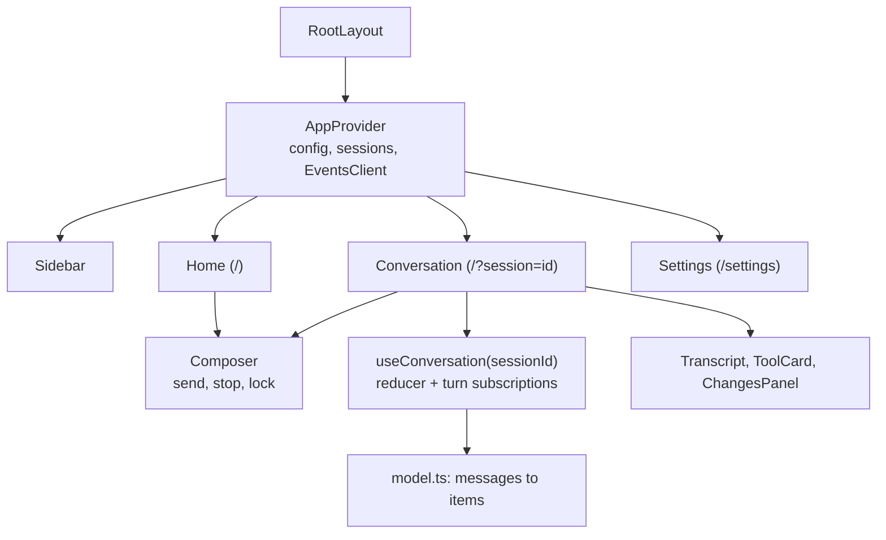

# 003 — Web App

## Status

Current. Implemented in `web/` and verified by its vitest suite and by hand against the pinned CLIs through the backend. The backend API this app consumes is owned by [design 001](001-architecture.md#api-surface).

## Why

The demo exists to test the SDK as a realistic consumer would ([design 001](001-architecture.md#why)). The consumer needs what users expect from a coding agent: sessions grouped by project, live tool activity, stop, diffs, worktrees, and history, for both harnesses. One clean interface over both harnesses shows that a single integration serves both, keeps the frontend small enough to change with the SDK, and still exercises every part of the API. Every control a desktop coding app would have either maps to the SDK or exposes a gap, so the gaps stay visible as disabled controls instead of being hidden.

## Summary

1. One Next.js app (App Router, client components only), styled with shadcn/ui and Tailwind CSS, statically exported to `web/out/` and served by the backend's `--web-dir`. In development, `next dev` proxies `/api` to the backend.
2. A sidebar lists the backend's sessions grouped by project; the main pane shows the home composer or one conversation. The harness is chosen per session in the home composer.
3. One `EventsClient` per tab holds the tab's only `EventSource`; conversations subscribe to turns through it and resubscribe from their last message ID after a reconnect.
4. A pure conversation model folds turn summaries and messages into items; shared renderers draw user, assistant, reasoning, tool, and turn-end items.
5. Every control the SDK cannot support is rendered disabled, with the reason from the [gap registry](001-architecture.md#sdk-gaps), and labeled with what actually runs.

Out of scope: dark theme, mobile layouts, and recreating any specific product's look. See [Non-Goals](#non-goals).

## Start Here

## Design Decisions

| Decision | Choice |
|---|---|
| Stack | Next.js (App Router), React, TypeScript (strict), Tailwind CSS, shadcn/ui; pnpm, prettier, eslint, vitest |
| Dependencies | shadcn/ui and what it installs (Radix primitives, `cmdk`, `cn`, `class-variance-authority`, `tw-animate-css`), `lucide-react`, `sonner` for toasts, `react-markdown` with `remark-gfm`, `diff` for line diffs; nothing else without a design change |
| Rendering | Every page is a client component; `output: "export"` with `trailingSlash: true` produces static files the backend serves. No server components fetch data, and no Next.js server runs in production |
| Development | `next dev` on `http://localhost:3000` rewrites `/api/*` to the backend at `http://127.0.0.1:8787`; the backend allows that origin through `--dev-origin`. Rewrites are configured only in development, because a static export has no server |
| Routing | `/` is home, `/?session=<id>` a conversation, `/settings` settings. Search parameters instead of path segments, because a static export cannot generate a page per session ID |
| State | React context for config, the session list, and the events client; one reducer per open conversation; no state library |
| Harness choice | A segmented control in the home composer; a session keeps its harness. The sidebar marks each session with its harness |
| New session | Created by the first message from home; no dialog |
| Keyboard | In the composer, Enter sends and Shift+Enter inserts a newline |
| Theme | Light only, shadcn's neutral palette; one accent per harness for badges and status (Claude Code amber, Codex sky) |
| Agent output | Rendered as text or markdown, never as raw HTML |
| Settings | Read-only; values come from `GET /api/config` |

## Directory Layout

| Path under `web/` | Owns |
|---|---|
| `src/app/` | `layout.tsx`, `page.tsx` (home or conversation by `?session`), `settings/page.tsx`, `globals.css` |
| `src/lib/api/` | `types.ts` (the [DTOs](001-architecture.md#message-dto) one to one), `client.ts` (JSON calls, error decoding), `events.ts` (`EventsClient`) |
| `src/lib/state/` | `AppProvider`, `useConversation` and its reducer, `model.ts` (the [fold](#conversation-model)), `format.ts` (durations, counts) |
| `src/components/ui/` | shadcn/ui components, as generated |
| `src/components/` | `Sidebar`, `Composer`, `ProjectPicker`, `Transcript`, `ToolCard`, `DiffView`, `Markdown`, `ChangesPanel`, `GapControl`, `ConnectionBanner`, `SettingsView` |
| `test/` | vitest tests and fictional DTO fixtures |

The backend serves `web/out/`; for `/settings/` it serves `settings/index.html`, and any other path that is not a file gets `index.html`.

## Data Flow

`AppProvider` loads `GET /api/config` and `GET /api/sessions`, and owns the tab's `EventsClient`. It applies `session.upserted` and `session.deleted` to the session list.

`EventsClient` opens one `EventSource` on `/api/events` and waits for `hello` to learn its connection ID. `subscribe(sessionId, turnId, handlers, lastMessageId)` posts the subscription and routes `message`, `stream.error`, and `turn.ended` for that `turnId` to the handlers. On every later `hello` (a reconnect) it reposts every live subscription with the last message ID its handler has seen, and the provider refetches the session list. A subscription ends after `turn.ended`. The server sends `retry: 3000`; when the `EventSource` is closed or has been disconnected for more than 3 seconds, a banner reads "Connection to the backend lost. Reconnecting..." with a "Reconnect" button.

`useConversation(sessionId)` loads `SessionDetail`, then `GET .../messages` for every ended turn, and subscribes to the `activeTurnId` if there is one. When `session.upserted` brings an `activeTurnId` it does not know (a turn started in another tab), it refetches `SessionDetail` and subscribes. An unknown session shows "Session not found" with the `history` reason, because a restarted backend forgets sessions.

Sending:

1. From home, the composer calls `POST /api/sessions` with the harness, project, model, and worktree choice, then navigates to `/?session=<id>`; the prompt is carried to the conversation.
2. The conversation shows the prompt as an optimistic user item, calls `POST .../turns`, and subscribes to the returned turn. The turn's `user` message replaces the optimistic item.
3. On a start error the optimistic item is removed, the prompt is restored to the input, and the error is shown above it. `start_cancelled` restores the prompt without an error.
4. The composer is locked while the session's `status` is `starting`, `running`, or `closing`, or while its own send is pending. It unlocks only when the session is `idle` and the started turn's `turn.ended` has arrived, or the start failed ([why](001-architecture.md#turn-flow)).
5. While a turn starts or runs, the send button is Stop (`POST .../stop`), and typing shows the hint "Not available: <steering reason>"; Enter sends nothing.

A prompt starting with "/" is sent as plain text; while the input starts with "/", a hint says "Slash commands are not interpreted; this is sent as plain text" (gap `slash-commands`).

## Conversation Model

`model.ts` is a pure function from turn summaries and their messages to items.

| Item | Built from |
|---|---|
| `user` | The `user` message, or the optimistic prompt until it arrives |
| `assistant` | An `assistant` message |
| `reasoning` | A `reasoning` message; empty text renders as a collapsed "Thought" row with no body |
| `tool` | A `tool_call` merged with the `tool_result` whose `callId` matches; a result with no call becomes a tool item on its own |
| `turnEnd` | The `TurnSummary` once the turn has ended |

Rules:

- Messages are de-duplicated by ID and kept in arrival order.
- A message with `parentToolUseId` is nested under the `subagent` tool item with that call ID; without one it stays at the top level.
- Tool state: `failed` when the result has `isError`; `succeeded` when a result exists; `running` when there is no result and the turn is running; `interrupted` when there is no result and the turn has ended.
- A non-zero shell exit code does not make a call `failed`; it shows as a badge.

## Renderers

### Tool card

A `ToolCard` is a collapsible row: tool icon, label, target in monospace muted text (paths relative to the session's WorkDir), and a status at the right (spinner, check, red cross, or "Interrupted"). Expanded, it shows "Input" and "Output" sections in monospace, capped at 320px with internal scroll.

| Tool | Label | Target | Expanded body |
|---|---|---|---|
| `shell` | Ran | `$ command` | Output; exit code badge when non-null and non-zero |
| `fileRead` | Read | Path, "lines a-b" when offset or limit is set | Content |
| `fileWrite` | Wrote | Path, `+N` | Content as an all-added diff |
| `fileEdit` | Edited | Path, `+N -M` from a line diff; "all occurrences" for `replaceAll` | `DiffView` of old and new strings |
| `filePatch` | Edited | First path and "+K more" | One unified diff per change with its kind |
| `glob`, `grep` | Searched | Pattern and path | Output text |
| `webFetch` | Fetched | Host of the URL | URL, prompt, output |
| `webSearch` | Searched the web | Query | Output |
| `mcp` | Called | `server · tool` | Arguments and content as formatted JSON |
| `subagent` | Delegated | Description, type badge when non-empty | Prompt, then nested items, then the result; open while running |
| `unknown` | The raw name | — | Raw input and output as formatted JSON |

A `truncated` message shows a "Truncated" badge on its card or text.

### Other pieces

- **Markdown** renders assistant text with GFM; web links open in a new tab with `rel="noopener noreferrer"`, and links to local files render as plain text; raw HTML is never rendered; code blocks are monospace with a copy button.
- **Working indicator**: a spinner, "Working", and the elapsed time since `startedAt`; it is the only progress signal between complete messages (gap `streaming-text`).
- **Turn end line**: the duration from `startedAt` to `endedAt`, with a tooltip of the non-zero usage counts ("1.8k in · 412 out · 20k cache read"). `terminated` and `cancelled` read "Stopped", `closed` "Session closed"; `failed` shows the error with "Retry", which sends the turn's prompt again.
- **ChangesPanel** is a right panel opened from the conversation header's `+N -M` button, which appears once the session has changed a file: a file list with status and counts and the selected file's diff, from `GET .../changes`, refreshed after each `turn.ended` (gap `changed-files`). Outside git it shows "Changes need a git repository"; a session without a worktree notes "Includes manual edits made in this directory".
- **Toasts** report results such as "Worktree kept: uncommitted changes" after a delete.
- **Harness notice** above the composer when the selected harness is unavailable or its version differs from a non-empty `pinnedVersion`, with the `loginHint` and a copy button. Send is disabled while the harness is unavailable. Below the home composer, a muted line shows the `loginHint` with a copy button, because an isolated home needs one login before its first session.

## Layout

| Region | Content |
|---|---|
| Sidebar (272px) | App name; "New session"; search field (gap `search`); sessions grouped by project, groups ordered by latest activity, rows with a status indicator (spinner while starting or running, red dot when the last turn failed), the title or "New session", and a harness badge; row menu "Delete session"; history note "Sessions from earlier backend runs are not listed" (gap `history`); footer with the display name and a settings link |
| Home | Centered heading "What should we build?", the composer card below it |
| Composer card | Textarea; a toolbar with the harness segmented control (home only), `ProjectPicker` (projects from `GET /api/projects` plus an absolute path entry; home only), a branch menu and "Worktree" switch for git projects (home only), the model picker (suggestions, "Default model", free text; read-only after start, gap `model-switch`), the disabled gap controls, and the send or Stop button |
| Conversation | A header with the title, harness badge, project and branch, the changes button, and a menu with "Delete session"; the transcript in a centered column up to 768px wide; the composer pinned at the bottom |
| Settings | Harnesses (availability, versions, home, login hint, models), projects and worktree root, storage note (gap `index-location`), and the full gap registry |

The project picker preselects the most recently used project (kept in `localStorage`), falling back to the first project. Without a project, Send is disabled.

## Disabled Gap Affordances

`GapControl` wraps a control and a gap ID: the control keeps its place at reduced opacity with `aria-disabled="true"`, stays focusable, and shows the tooltip "Not available: <reason>". Activation does nothing. Reasons come from `GET /api/config`.

| Control | Gap |
|---|---|
| Sidebar search | `search` |
| "Bypass permissions" (Claude Code) or "Full access" (Codex) | `permissions` |
| "Default effort" | `effort` |
| Attachments "+" | `attachments` |
| Microphone | `voice` |
| "Local" environment label | `cloud` |
| Model picker after the session started | `model-switch` |
| Steering hint while a turn runs | `steering` |
| History note | `history` |

## Invariants

- A tab holds exactly one `EventSource`, owned by `EventsClient`.
- Messages are identified only by `Message.ID`; replay positions are message IDs.
- The composer unlocks only on `turn.ended` of a started turn, or a failed start.
- Agent output is never rendered as HTML.
- Every unsupported control is a `GapControl` with a registered gap ID, labeled with what actually runs.
- The production build is a static export; the backend is the only server.
- No official asset, private data, or font file is committed.

## Non-Goals

- **Recreating a specific product's look.** The app follows shadcn/ui conventions instead.
- **Dark theme and mobile layouts.**
- **Approval prompts.** Harnesses never ask ([SDK permissions](../../design/001-core-api.md#design-decisions)).
- **Plan and task panels.** Task tools render as `unknown` tool cards (gap `plan`).
- **Per-turn changes.** Changes are per session ([design 001](001-architecture.md#non-goals)).
- **Editing settings in the UI.** Configuration is by backend flags.

## Testing

- **Model tests** (vitest) run fictional fixtures through `model.ts`: de-duplication across a resubscribe, call and result merging, nesting under subagents, orphans, interrupted calls in ended turns, and optimistic replacement.
- **Reducer tests** cover start errors, `start_cancelled`, `turn.ended` unlocking, `stream.error`, and a turn started in another tab.
- **Events client tests** cover routing by `turnId`, resubscription with the last message ID on `hello`, and the end of a subscription after `turn.ended`.
- `tsc --noEmit`, eslint, prettier, and `next build` run with the tests.
- The backend's static serving of the export is covered by [design 001](001-architecture.md#testing)'s router tests.

## References

- [design 001](001-architecture.md): the backend API, message DTOs, event stream, and gap registry this app consumes.
- [design/001-core-api.md](../../design/001-core-api.md#messages): the message and tool model behind the DTOs.
- [shadcn/ui](https://ui.shadcn.com): the component conventions the app follows.
