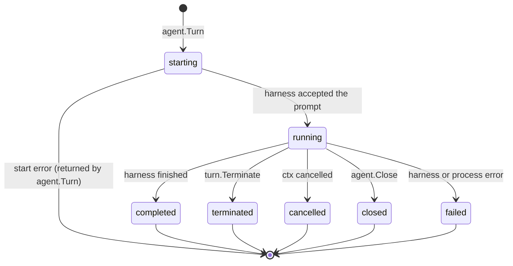

# 001 — Core API

## Status

Draft. Nothing is implemented. This document defines the first public surface of package `cloudagent` and the harness behavior behind it.

## Why

Claude Code and Codex are each scriptable, but through unrelated contracts. Claude Code speaks newline-delimited stream-json with a bidirectional control protocol. Codex speaks JSON-RPC through `codex app-server`. They name the same actions differently (`Bash` versus `commandExecution`, `Edit` versus `fileChange`), shape tool inputs differently, and store transcripts in different layouts. A program that wants to drive either harness has to learn both, and every consumer ends up re-normalizing harness output on its own, usually incompletely.

The root problem is the missing abstraction, not a missing feature. Callers need one object model for an agent, a turn, and the messages a turn produces, normalized once at the source, so that code written against one harness runs unchanged against the other.

## Summary

1. `cloudagent.New(harness, options)` returns an `AgentRuntime`: one agent backed by one harness, holding one linear conversation.
2. `agent.Turn(ctx, prompt, options)` starts one turn and returns a `Turn` handle as soon as the harness is executing.
3. `turn.Messages()` yields complete, typed canonical messages; `turn.Result()` blocks for the outcome; `turn.Terminate()` stops the turn gracefully.
4. `agent.Close()` stops any active turn and releases the harness process.
5. Harnesses run without permission prompts.
6. Conversation data lives only in the harness home (`~/.claude`, `~/.codex`, or `Options.Home`). `~/.cloudagent` stores index relations that point into it.

This version does not provide streaming deltas, hooks, custom tools, configurable permissions, rollback, fork, resume of a previous agent, or remote execution. See [Non-Goals](#non-goals).

## Start Here

An `AgentRuntime` is a conversation; a `Turn` is one exchange in it. At most one turn runs at a time, and each turn moves through one lifecycle:



```go
import cloudagent "github.com/wenfengwang/cloud-agent-sdk"

agent, err := cloudagent.New(cloudagent.Claude, cloudagent.Options{WorkDir: "."})
if err != nil {
	return err
}
defer agent.Close()

turn, err := agent.Turn(ctx, "fix the failing test", cloudagent.TurnOptions{})
if err != nil {
	return err
}

for msg, err := range turn.Messages() {
	if err != nil {
		return err
	}
	if call := msg.ToolCall; call != nil {
		if sh, ok := call.Input.(*cloudagent.ShellInput); ok {
			fmt.Println("$", sh.Command)
		}
	}
}

res, err := turn.Result()
```

Code layout:

| Path | Owns |
|---|---|
| `cloudagent.go` and siblings (package `cloudagent`) | The entire public API: constructors, handles, message and tool types, errors |
| `internal/agent` | Turn lifecycle, the single-active-turn rule, the in-memory message buffer, the `~/.cloudagent` index |
| `internal/claude` | Claude Code process, stream-json protocol, translation, transcript reading |
| `internal/codex` | `codex app-server` process, JSON-RPC protocol, translation, rollout reading |

## Design Decisions

| Decision | Choice |
|---|---|
| Public surface | One package, `cloudagent`, at the module root; all implementation under `internal/` |
| Harnesses | `cloudagent.Claude` drives Claude Code; `cloudagent.OpenAI` drives Codex |
| Construction | `New` validates options, assigns an agent ID, and writes the index entry; it starts no process and creates no session |
| Process model | Hidden from callers. Claude Code runs one process per turn; Codex runs one `codex app-server` process per `AgentRuntime`, started by the first turn |
| Shutdown | `Close` stops the active turn through the graceful stop path, waits for it to end, and stops the harness process; later calls fail with `ErrClosed` |
| Permissions | Harnesses run without permission prompts: Claude Code with `--permission-mode bypassPermissions`, Codex with approval policy `never` and sandbox `danger-full-access` |
| Concurrency | `AgentRuntime` is safe for concurrent use; at most one turn is active, and a second `Turn` call fails with `ErrTurnInProgress` |
| Turn return | `Turn` returns after the harness accepts the prompt; start failures are returned synchronously, execution failures by `Result` |
| Identity | Agent and turn IDs are generated by cloudagent (UUIDv7) and mapped internally to harness IDs |
| Stopping | `Terminate` and context cancellation take the same graceful stop path; `Result` returns `ErrTerminated` or `ctx.Err()` respectively |
| After a stop | The conversation keeps everything the stopped turn produced; the next turn continues from it |
| Message granularity | Complete messages only; no deltas |
| Message model | Typed canonical messages: tool calls and results are separate messages with typed inputs and outputs; unmapped tools fall back to `Unknown`; every message carries its raw harness JSON |
| Unmapped harness items | Harness items that are neither a message kind nor a tool call are not emitted |
| Normalization | Done once, in the harness adapter, before a message reaches any consumer |
| Message replay | Every `Messages()` call iterates from the turn's first message; a running turn is buffered in memory, a finished turn is read from the harness home |
| Data ownership | The harness home holds the only copy of conversation data; `~/.cloudagent` holds index relations only |
| Options | `Options` has `Model`, `WorkDir`, `Home`; `TurnOptions` exists with no fields |

## API Surface

### Construction

```go
type Harness string

const (
	Claude Harness = "claude"
	OpenAI Harness = "openai"
)

type Options struct {
	Model   string // empty selects the harness's default model
	WorkDir string // required; the harness's working directory
	Home    string // harness home; empty selects ~/.claude or ~/.codex
}

func New(h Harness, opts Options) (*AgentRuntime, error)
```

`New` fails when the harness is unknown, `WorkDir` is empty or not a directory, or the index entry cannot be written. It does not check that the harness CLI is installed; that surfaces as a start error from the first `Turn`.

`Home` maps to `CLAUDE_CONFIG_DIR` for Claude Code and to `CODEX_HOME` for Codex. It selects the credentials, settings, and transcript store the harness uses, so distinct homes isolate agents from each other.

### AgentRuntime

```go
func (a *AgentRuntime) ID() string
func (a *AgentRuntime) Turn(ctx context.Context, prompt string, opts TurnOptions) (*Turn, error)
func (a *AgentRuntime) Close() error

type TurnOptions struct{}
```

`Turn` returns a start error when the agent is closed (`ErrClosed`), another turn is active (`ErrTurnInProgress`), the prompt is empty, the harness CLI cannot be started, or the harness rejects the prompt. Once it returns a `*Turn`, every later failure is reported by `Turn.Result`.

`ctx` governs the turn's execution, not only the call: cancelling it after `Turn` returns stops the turn.

`Close` stops the active turn, if any, through the graceful stop path and waits for it to end; that turn's `Result` returns `ErrClosed`. It then stops the harness process. `Close` is idempotent. After it returns, `Turn` fails with `ErrClosed`; turns that already ended can still be read.

### Turn

```go
func (t *Turn) ID() string
func (t *Turn) Messages() iter.Seq2[Message, error]
func (t *Turn) Result() (Result, error)
func (t *Turn) Terminate() error

type Result struct {
	TurnID    string
	FinalText string // text of the last assistant message
	Usage     Usage
}

type Usage struct {
	InputTokens      int64
	OutputTokens     int64
	CacheReadTokens  int64
	CacheWriteTokens int64
}
```

- `Messages` may be called any number of times, concurrently, during or after the turn. Each call yields every message from the first, then blocks for new ones until the turn ends. A non-nil error means messages could not be read; it ends the iteration.
- A turn runs to its end whether or not anyone consumes `Messages`.
- `Result` blocks until the turn ends and returns the same values on every call. It returns `ErrTerminated` after `Terminate`, `ctx.Err()` after cancellation, and a wrapped harness error after a failure.
- `Terminate` requests a graceful stop and returns without waiting; call `Result` to wait. Calling it on a finished turn is a no-op.

### Errors

```go
var (
	ErrTurnInProgress = errors.New("cloudagent: a turn is already in progress")
	ErrTerminated     = errors.New("cloudagent: turn terminated")
	ErrClosed         = errors.New("cloudagent: agent closed")
)
```

All other errors are wrapped with context and can be inspected with `errors.Is` and `errors.As`.

## Messages

### Message

```go
type Kind string

const (
	KindUser       Kind = "user"
	KindAssistant  Kind = "assistant"
	KindReasoning  Kind = "reasoning"
	KindToolCall   Kind = "tool_call"
	KindToolResult Kind = "tool_result"
)

type Message struct {
	ID              string
	TurnID          string
	ParentToolUseID string // non-empty when produced inside a subagent
	Kind            Kind

	// Exactly one is set, matching Kind.
	User       *Text
	Assistant  *Text
	Reasoning  *Text
	ToolCall   *ToolCall
	ToolResult *ToolResult

	Raw json.RawMessage // the harness's original JSON for this message
}

type Text struct{ Text string }

type ToolCall struct {
	ID      string
	Name    ToolName
	RawName string // the harness's tool name
	Input   ToolInput
}

type ToolResult struct {
	CallID  string
	Name    ToolName
	Output  ToolOutput
	IsError bool
}
```

`ToolCall` is emitted when the harness issues the call and `ToolResult` when it completes, correlated by `CallID`. Merging the two into one row is a consumer concern.

### Tools

`ToolInput` and `ToolOutput` are sealed interfaces; consumers use a type switch. Each `ToolName` has one input type and one output type.

| `ToolName` | Input | Output | Claude Code | Codex |
|---|---|---|---|---|
| `shell` | `ShellInput{Command, Description, TimeoutMs}` | `ShellOutput{Output, ExitCode *int}` | `Bash` | `commandExecution` |
| `file_read` | `FileReadInput{Path, Offset, Limit}` | `FileReadOutput{Content}` | `Read` | — |
| `file_write` | `FileWriteInput{Path, Content}` | `TextOutput{Text}` | `Write` | — |
| `file_edit` | `FileEditInput{Path, OldString, NewString, ReplaceAll}` | `TextOutput{Text}` | `Edit` | — |
| `file_patch` | `FilePatchInput{Changes []FileChange{Path, Kind, Diff}}` | `TextOutput{Text}` | — | `fileChange` |
| `glob` | `GlobInput{Pattern, Path}` | `TextOutput{Text}` | `Glob` | — |
| `grep` | `GrepInput{Pattern, Path, Glob}` | `TextOutput{Text}` | `Grep` | — |
| `web_fetch` | `WebFetchInput{URL, Prompt}` | `TextOutput{Text}` | `WebFetch` | — |
| `web_search` | `WebSearchInput{Query}` | `TextOutput{Text}` | `WebSearch` | `webSearch` |
| `mcp` | `MCPInput{Server, Tool, Arguments}` | `MCPOutput{Content}` | `mcp__<server>__<tool>` | `mcpToolCall` |
| `subagent` | `SubagentInput{Description, Prompt, Type}` | `TextOutput{Text}` | `Agent` | `collabAgentToolCall` |
| `todo` | `TodoInput{Items []TodoItem{Text, Status}}` | `TextOutput{Text}` | `TodoWrite` | — |
| `unknown` | `UnknownInput{Raw}` | `UnknownOutput{Raw}` | any other tool | any other tool item |

Normalization rules applied at the source:

- `ShellInput.Command` is the command the model asked for, with any login-shell wrapper (for example `/bin/bash -lc '<cmd>'`) removed.
- `ShellOutput.ExitCode` is nil when the harness does not report one.
- Paths are reported as the harness reported them; they are not rewritten.

### Harness message mapping

| Canonical | Claude Code (stream-json) | Codex (app-server items) |
|---|---|---|
| `user` | the turn's user message | `userMessage` |
| `assistant` | `text` content block of an assistant message | `agentMessage` |
| `reasoning` | `thinking` content block | `reasoning` (summary text) |
| `tool_call` | `tool_use` content block | `item/started` of a tool item |
| `tool_result` | `tool_result` content block of a user message | `item/completed` of a tool item |

Codex `imageView` items are emitted as `unknown` tool calls. Codex `plan`, `imageGeneration`, `contextCompaction`, `subAgentActivity`, and review-mode items are not emitted.

## Harness Behavior

| | Claude Code | Codex |
|---|---|---|
| Process | One per turn: `claude --print --output-format stream-json --input-format stream-json --verbose`, with `--resume <session-id>` after the first turn | One `codex app-server` per `AgentRuntime`; `initialize`, then `thread/start` (first turn) or the existing thread, then `turn/start` per turn |
| Turn accepted | The process started and the prompt was written | `turn/start` returned |
| Permissions | `--permission-mode bypassPermissions` | approval policy `never`, sandbox `danger-full-access` |
| Graceful stop | `interrupt` control request | `turn/interrupt` |
| Close | No process outlives a turn | `app-server` process stopped |
| Harness home | `CLAUDE_CONFIG_DIR` | `CODEX_HOME` |
| Transcript | `<home>/projects/<encoded-workdir>/<session-id>.jsonl` | `<home>/sessions/<yyyy>/<mm>/<dd>/rollout-*-<thread-id>.jsonl` |
| Turn reference | `{session_id, user_message_uuid}` | `{thread_id, turn_id}` |

## Data Model

```
~/.cloudagent/
└── agents/<agent-id>/
    ├── agent.json    # {harness, model, workdir, home, harness_session_id}
    └── turns.jsonl   # one line per turn: {turn_id, harness_ref, status, started_at, ended_at}
```

`harness_ref` is the turn reference from [Harness Behavior](#harness-behavior). `status` is one of `running`, `completed`, `terminated`, `cancelled`, `closed`, `failed`. Nothing in `~/.cloudagent` copies message content.

## Invariants

- The harness home is the only store of conversation data. `~/.cloudagent` holds IDs, references, and status, never message content.
- Package `cloudagent` is the only public package; nothing under `internal/` is part of the API.
- At most one turn is active per `AgentRuntime`.
- `Turn` reports start failures synchronously; every failure after it returns is reported by `Result`.
- Messages are complete and typed. Harness differences are normalized in the adapter; no harness-specific tool name or input shape appears outside `RawName` and `Raw`.
- A tool call and its result are two messages correlated by `CallID`.
- `Messages()` always starts from the turn's first message, during and after the turn.
- `Terminate`, context cancellation, and `Close` stop a turn through the same path and differ only in the error `Result` returns.
- No harness process outlives `Close`.
- Harnesses never wait on a permission prompt.

## Non-Goals

- **Streaming deltas.** Only complete messages are emitted; partial text and thinking deltas need their own design.
- **Hooks and custom tools.** Intercepting tool calls or registering in-process tools needs its own design.
- **Permission and sandbox control.** Harnesses always run in bypass mode; restricting them needs its own design, together with hooks to answer approvals.
- **Rollback, fork, and steering.** Conversation history editing and injecting input into a running turn need their own design.
- **Resuming a previous agent.** An `AgentRuntime` cannot be reopened from its ID yet, although the index is written so that it can be added.
- **Remote or sandboxed execution.** Harnesses run as local processes.
- **Workspace rollback.** Files an agent changes are never reverted by cloudagent.

## Testing

- **Translation tests.** Recorded harness output (Claude stream-json lines, Codex app-server notifications) is fed through each adapter and compared against golden canonical messages, one fixture per row of the tool and message mapping tables.
- **Lifecycle tests.** A fake harness process drives every transition in the turn lifecycle: start failure, completion, `Terminate`, context cancellation, `Close` during a turn, process crash, `ErrTurnInProgress`, and `ErrClosed`; no fake process survives `Close`.
- **Replay tests.** Concurrent `Messages()` consumers during a turn see identical sequences, and the same sequence (minus fields harnesses do not persist) is read back from the harness home after the turn.
- **Index tests.** `~/.cloudagent` entries are written for every turn and never contain message content.
- **Harness tests.** End-to-end runs against the real Claude Code and Codex CLIs, enabled by `CLOUDAGENT_E2E=1`.

## Open Questions

- **Read-back differences.** Harnesses do not persist everything they stream (Codex documents its persisted items as lossy). Which fields may differ between a live read and a read-back must be listed once the adapters exist.
