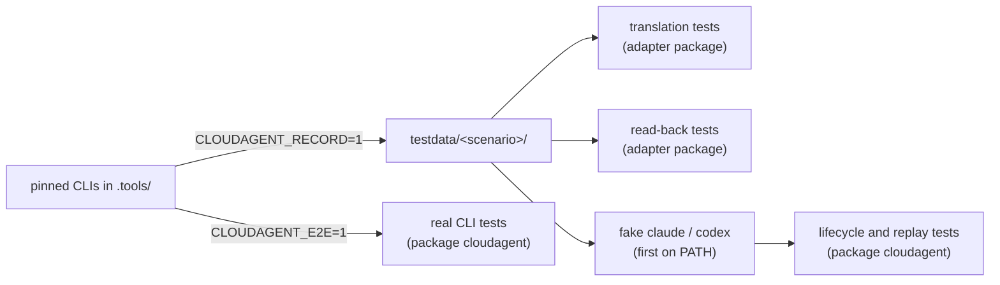

# 002 — Testing

## Status

Draft. Nothing is implemented. This document defines how the contract in [design 001](001-core-api.md) is verified: the test layers, the fixture format and how fixtures are recorded, the fake harness executables, and the isolation and credential rules every test follows.

## Why

cloudagent is a translation layer over two harnesses whose behavior it does not control. Its correctness depends on what the pinned Claude Code and Codex CLIs actually emit, not on what their documentation says, and on lifecycle edge cases (hangs, crashes, ignored interrupts) that the real CLIs produce only rarely and never on demand.

Hand-written harness output encodes the author's assumptions and silently drifts from the real protocol. Tests that only run against the real CLIs are slow, cost money, need credentials, and cannot script failures. The root problem is getting tests that are both faithful to real harness behavior and deterministic. Recording real traffic once per pinned version and replaying it, both directly into the adapters and through fake executables behind the public API, gives both.

## Summary

1. **Translation tests** feed recorded raw harness output through each adapter and compare the result with golden canonical messages, one fixture per scenario.
2. **Lifecycle tests** drive the public API against fake `claude` and `codex` executables, built by the tests and placed first on `PATH`, that replay recorded traffic and script hangs, crashes, and interrupt handling.
3. **Replay and read-back tests** check concurrent `Messages()` consumers, read-back of finished turns from the harness home, and that `~/.cloudagent` never contains message content.
4. **Real CLI tests** run the scenarios against the pinned CLIs when `CLOUDAGENT_E2E=1`, and fail when an installed CLI's version differs from its pin.
5. **Fixtures are recorded** from the pinned CLIs by tests gated on `CLOUDAGENT_RECORD=1`, scrubbed of credentials, and re-recorded on every version bump. They are never written by hand.

Testing adds no seam to the public API: the fake harnesses are found through `PATH` exactly as the real CLIs are.

## Start Here

Real CLIs are touched in two places only: recording and real CLI tests. Everything else runs offline from committed fixtures.



Code layout:

| Path | Owns |
|---|---|
| `scripts/install-harnesses.sh` | Installs the pinned CLIs into `.tools/` |
| `internal/testenv` | Test support shared by all layers: repository root, pinned versions, `.tools` lookup, credential loading, scenario definitions, fixture reading and writing, scrubbing |
| `internal/fakeharness` | The fake harness executable (`package main`) |
| `internal/claude/testdata/<scenario>/`, `internal/codex/testdata/<scenario>/` | Recorded fixtures and goldens |
| `internal/claude/*_test.go`, `internal/codex/*_test.go` | Recording, translation, and read-back tests |
| `*_test.go` at the module root | Lifecycle, replay, index, and real CLI tests through the public API |

## Design Decisions

| Decision | Choice |
|---|---|
| Source of harness output | Recorded from the pinned CLIs; never hand-written |
| Recording | Tests gated on `CLOUDAGENT_RECORD=1`, one per adapter package, writing `testdata/<scenario>/` |
| Re-recording | Every fixture is re-recorded when a pin in `harness-versions.json` changes; a test fails when a fixture's recorded version differs from the pin |
| Translation oracle | Golden canonical messages per scenario, plus per-scenario structural expectations that every re-recorded golden must still satisfy |
| Lifecycle harness | A fake executable built by the tests, named `claude` and `codex`, placed first on `PATH` |
| Fake configuration | A script file named by `CLOUDAGENT_FAKE_SCRIPT`, inherited from the test process environment; read only by the fake |
| Public API seams | None; lifecycle tests use only the exported API |
| Isolation | `HOME` and every harness home are `t.TempDir()` in every test |
| Credentials | Only from `.harness-local/`, only passed to the pinned CLIs, scrubbed from fixtures |
| Pinned CLIs | Installed into the git-ignored `.tools/` by a committed script; tests that need them put `.tools/node_modules/.bin` first on `PATH` |
| Real CLI gate | `CLOUDAGENT_E2E=1`; a version mismatch or missing CLI fails the test, it does not skip |

Golden files alone would accept any re-recorded output, so each scenario also states what it must contain (for example, a `shell` tool call whose command contains `sleep 30`, followed by `ErrTerminated`). A re-recording that no longer exercises its mapping row fails instead of silently updating the golden.

The fake reads its script from an environment variable because the SDK starts harness processes with the parent process environment, as the real CLIs require for their own configuration. The variable means nothing to the SDK.

## Test Layers

### 1. Translation tests

Live in each adapter package and run offline. For every scenario fixture, the test feeds the recorded `recv` lines of each `traffic-<n>.jsonl` through the adapter's translation, in order, and compares the canonical messages with `messages.golden.json`. `go test -run TestTranslate -update` rewrites the goldens; updated goldens are reviewed like code.

Each scenario then checks its structural expectations from [Scenarios](#scenarios) against the translated messages, independently of the golden.

### 2. Lifecycle tests

Live at the module root and use only the exported API. `TestMain` builds `internal/fakeharness` once into a temporary directory as both `claude` and `codex`, and every lifecycle test puts that directory first on `PATH`.

| Transition or rule | How it is driven | Expected |
|---|---|---|
| CLI not installed | `PATH` without the fake | `Turn` returns a start error |
| Harness rejects the prompt | Script answers the start request with an error (Codex) or exits before accepting (Claude) | `Turn` returns a start error; no turn is recorded as running |
| Completion | Replay `text` | `Result` returns the recorded final text and usage; status `completed` |
| `Terminate` | Replay `terminate` | `Result` returns `ErrTerminated`; status `terminated` |
| Context cancellation | Replay `terminate`, cancel `ctx` | `Result` returns `ctx.Err()`; status `cancelled` |
| `Close` during a turn | Replay `terminate`, call `Close` | `Result` returns `ErrClosed`; status `closed`; no fake process alive |
| Process crash | Script exits non-zero after the first lines | `Result` returns a wrapped harness error; status `failed` |
| Interrupt ignored | Script hangs and ignores the graceful stop | The turn still ends and the process is gone (see [Open Questions](#open-questions)) |
| Single active turn | Script hangs; call `Turn` again | Second call returns `ErrTurnInProgress` |
| After `Close` | Call `Turn` | Returns `ErrClosed`; ended turns remain readable |
| Continuity | Replay `two-turn` | Claude's second process is started with `--resume <session-id>`; Codex reuses its thread |
| No permission prompts | Any replay | The fake's received arguments and requests carry the bypass settings from design 001 |

The fake records its process ID and every line it receives in a state directory named by the script; tests read them to assert arguments, requests, and that no fake process survives `Close`.

### 3. Replay and read-back tests

| Check | Where | How |
|---|---|---|
| Concurrent consumers | Module root, fake | Several goroutines call `Messages()` at different points of a paced replay; all see the same sequence from the first message |
| Read-back equals live | Adapter package, fixtures | The fixture's `home/` tree is copied into a temporary harness home; reading the turn back yields the golden messages, except for the fields design 001 lists as not persisted |
| Read-back through the API | Module root, fake | The fake writes the fixture's transcript into the harness home; `Messages()` after the turn ends yields the same sequence as during it |
| Index has no content | Module root, fake and real CLI | After the turns, no file under `$HOME/.cloudagent` contains the prompt or any message text, tool input, or tool output of the run; `agent.json` and `turns.jsonl` hold exactly the fields of design 001 |

### 4. Real CLI tests

Live at the module root and run only when `CLOUDAGENT_E2E=1`. Each test:

1. Puts `.tools/node_modules/.bin` first on `PATH` and fails if `claude --version` or `codex --version` differs from `harness-versions.json` or the CLI is missing.
2. Prepares the isolated environment and credentials described in [Isolation and Credentials](#isolation-and-credentials), failing if `.harness-local/` is incomplete.
3. Runs the scenarios through the public API and checks their structural expectations, the read-back, and the index.

## Fixtures

### Layout

```
internal/<adapter>/testdata/<scenario>/
├── meta.json             # {harness, version, scenario, prompts}
├── traffic-1.jsonl       # one file per harness process, in start order
├── traffic-2.jsonl       # (Claude two-turn only: one process per turn)
├── home/                 # transcript files copied from the harness home, paths relative to it
│   └── ...
└── messages.golden.json  # canonical messages, including Raw
```

Each `traffic-<n>.jsonl` line is `{"dir": "send" | "recv", "line": <JSON>}`: `send` is what the adapter wrote to the process's stdin, `recv` is a line the process wrote to stdout, in the order observed. `home/` holds the Claude project transcripts (including subagent transcripts) or the Codex rollout files the turn produced.

Recorded absolute paths are replaced with placeholders so fixtures do not depend on the machine:

| Placeholder | Replaces |
|---|---|
| `@HOME@` | The temporary `HOME` |
| `@HARNESS_HOME@` | The temporary harness home |
| `@WORKDIR@` | The temporary working directory |
| `@WORKDIR_ENCODED@` | The working directory as Claude Code encodes it in transcript directory names |

Consumers of a fixture substitute the placeholders back with their own temporary paths.

### Recording

Recording tests live in each adapter package and run only when `CLOUDAGENT_RECORD=1`:

```bash
scripts/install-harnesses.sh
CLOUDAGENT_RECORD=1 go test ./internal/claude ./internal/codex -run TestRecord
```

For each scenario, the recording test seeds a temporary working directory, drives the pinned CLI through the adapter's own process and protocol code with a traffic tap attached, performs the scenario's actions (further prompts, the terminate request), copies the harness home's transcript files, scrubs everything, and writes the fixture. The tap is internal to the adapter package; it is not part of the public API.

Scrubbing replaces with `REDACTED` every credential value loaded from `.harness-local/`, bearer tokens, authorization headers, and anything matching an API key pattern, then replaces paths with the placeholders above. The recording fails, writing nothing, if any loaded credential value is still present afterwards.

### Scenarios

Each scenario is defined once in `internal/testenv` with harness-neutral prompts and seed files, and recorded for both harnesses. The expectations name the canonical rows of design 001 each fixture must cover; Codex exposes no dedicated file, search, or todo tools, so its expectations differ.

| Scenario | Prompt intent | Claude Code must produce | Codex must produce |
|---|---|---|---|
| `text` | Reply with a fixed sentence, no tools | `user`, `assistant` | `user`, `assistant` |
| `shell` | Run one shell command | `shell` call and result with exit code | `shell` call and result, login-shell wrapper removed |
| `read-file` | Read a seeded file and quote a line | `file_read` call and result | a `shell` call that reads the file |
| `write-file` | Create a new file with given content | `file_write` call and result | `file_patch` with an add change |
| `edit-file` | Change one word in a seeded file | `file_edit` call and result | `file_patch` with an update change |
| `glob-grep` | List files by pattern, then search for a word | `glob` and `grep` calls and results | `shell` calls |
| `subagent` | Delegate a small task to a subagent | `subagent` call; messages inside it carry `ParentToolUseID` | `subagent` call (see [Open Questions](#open-questions)) |
| `todo` | Track a three-step plan as a todo list | `todo` call with three items | no `todo` message (`plan` items are not emitted) |
| `terminate` | Run `sleep 30`; the turn is terminated once the `shell` call appears | `shell` call; the turn ends as terminated | `shell` call; the turn ends as terminated |
| `two-turn` | Remember a word; in a second turn, ask for it | second turn's final text contains the word | second turn's final text contains the word |

`reasoning` is covered wherever a recorded scenario contains it; the Codex fixtures also cover configuration warnings, which must yield no message and no failure.

## Isolation and Credentials

- Every test sets `HOME` to `t.TempDir()` and passes a `t.TempDir()` as `Options.Home`, so `~/.cloudagent`, `~/.claude`, and `~/.codex` of the developer are never read or written. A test that leaves `Options.Home` empty does so only to check the default, under the temporary `HOME`.
- Credentials live only in the git-ignored `.harness-local/`: `claude.env` (environment for Claude Code), `codex.env` (the Codex API key), and `codex-config.toml` (the Codex provider and model configuration). Only recording and real CLI tests read them, and only the pinned CLIs receive them.
- Claude Code: the variables of `claude.env` are set in the test process environment, which the CLI inherits, and `CLAUDE_CONFIG_DIR` is the temporary harness home.
- Codex: the temporary harness home receives a copy of `codex-config.toml` as `config.toml`, and `codex login --with-api-key` runs with `CODEX_HOME` set to it and the key on stdin.
- No test calls a model API directly, and no test prints or logs a credential value; failures report which variable is missing, never its value.

## Pinned CLIs

`scripts/install-harnesses.sh` reads the pins from `harness-versions.json` and installs exactly those versions with `pnpm add --dir .tools @anthropic-ai/claude-code@<claude> @openai/codex@<codex>`, then checks each binary's `--version`. It never touches a global install. Tests locate the binaries in `.tools/node_modules/.bin`.

## Invariants

- No fixture is hand-written; every fixture is produced by a recording test from the pinned CLI version stated in its `meta.json`, and that version equals the current pin.
- No committed fixture contains a credential, bearer token, or authorization header.
- Every test runs with `HOME` and every harness home under `t.TempDir()`.
- Credentials are read only from `.harness-local/` and passed only to the pinned CLIs.
- The public API has no test-only seams; the fake harnesses are reached through `PATH` like the real CLIs.
- Real CLI tests fail, never skip, on a version mismatch once `CLOUDAGENT_E2E=1` is set.
- Plain `go test ./...` needs no network, credentials, or installed CLI.

## Non-Goals

- **Model quality.** Tests check translation and lifecycle, not whether the model's answers are good.
- **Unpinned versions.** No test runs against any other harness version.
- **Byte-exact replay of model output.** Re-recording changes goldens; structural expectations keep the coverage stable.
- **CI credentials.** Running real CLI tests in CI needs its own design for secret handling.

## Testing

This design is verified by the tests it defines: the fixture version check enforces re-recording, the recording-time scrub check and a search of staged changes for key patterns before every commit enforce credential hygiene, and plain `go test ./...` passing on a machine without `.tools/` or `.harness-local/` enforces offline determinism.

## Open Questions

- **Escalation after an ignored stop.** Design 001 requires that a stopped turn ends and that no process outlives `Close`, but does not bound how long the graceful stop may take before the process is killed. The interrupt-ignored lifecycle test needs that bound.
- **Rows without a scenario.** `web_fetch`, `web_search`, `mcp`, and `unknown` have no scenario yet, so their mapping rows are not covered by fixtures.
- **Codex subagents.** Whether the pinned Codex with the local configuration emits `collabAgentToolCall` for the `subagent` prompt is unverified; if it does not, the Codex `subagent` fixture asserts only that no failure occurs.
- **Read-back differences.** The fields that may differ between live and read-back messages are owned by [design 001](001-core-api.md#open-questions); the read-back tests compare everything else.

## References

- [001 — Core API](001-core-api.md): the contract these tests verify.
- [harness-versions.json](../harness-versions.json): the pinned CLI versions fixtures are recorded from.
- [internal/codex/AGENTS.md](../internal/codex/AGENTS.md): regenerating the Codex protocol schema on a version bump.
